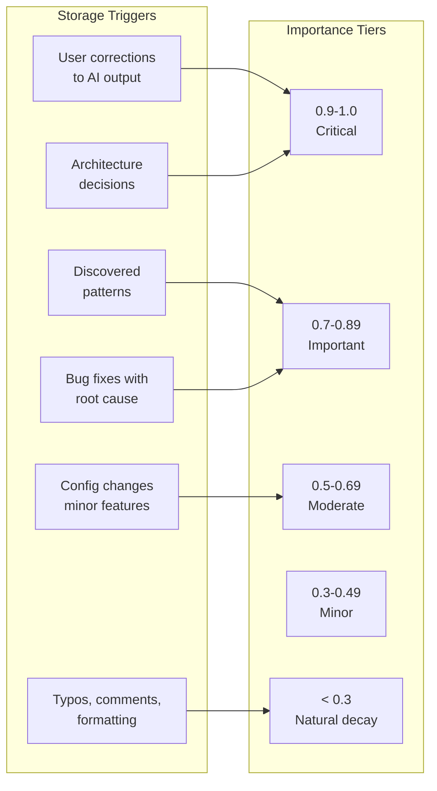
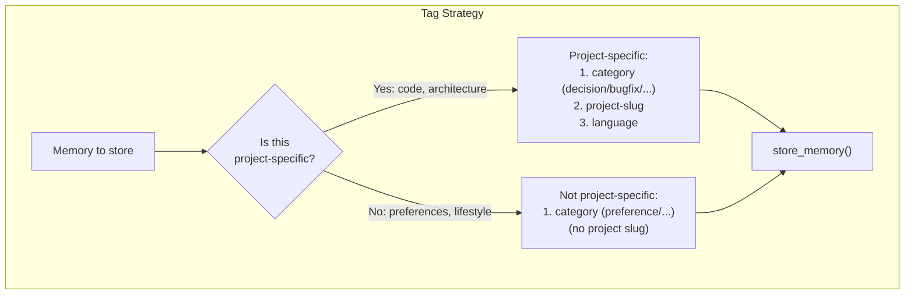
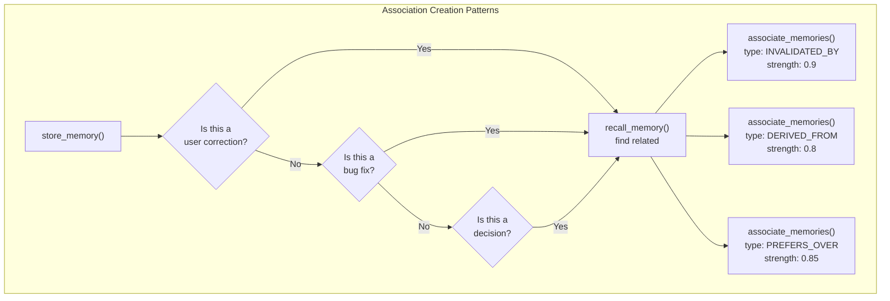

This page provides a comprehensive reference for memory-first development patterns used with the AutoMem MCP server. It documents proven strategies for memory recall, storage patterns, importance scoring, tagging conventions, and relationship management that enable AI assistants to maintain persistent context across sessions.

This page focuses on **usage patterns and best practices** for the six MCP tools. For tool schemas and API details, see the [Memory Operations](/docs/reference/api/memory-operations/) reference. For platform-specific integration setup, see the [Platform Integration Guides](/docs/platforms/claude-desktop/).

---

## Memory-First Development Philosophy

The memory system implements a **trust-based architecture**: AI assistants have direct access to MCP memory tools and are guided by instructions to make intelligent decisions about what to store and when to recall. This contrasts with automated capture systems that attempt to guess significance.

**Core principle**: `Trust AI + good instructions > automated hooks that guess significance`

This philosophy evolved from early experiments with hook-based automation (Claude Code) toward instruction-based patterns (Cursor, Codex). The instruction-based approach proved more reliable because the AI can contextualize significance better than automated event capture.

:::note[Hook system history]
The hook system was experimentally implemented for Claude Code (v0.5.0) and Cursor (v0.5.0), then removed in v0.8.0 and v0.6.0 respectively. Those hooks captured activity such as edits, builds, tests, and deploys mechanically. Claude Code installs now ship advisory hooks instead: a SessionStart hook that prompts the two-phase recall, and an optional Stop hook that nudges once when a substantive session stored nothing. They prompt and observe; they never write memories themselves. See [Custom Integrations](/docs/best-practices/progressive-disclosure/) for the current template-based integration path.
:::

---

## Recall Strategies

### Basic Recall Patterns

The `recall_memory` tool supports five fundamental recall strategies, often used in parallel:

| Strategy | Use Case | Parameters | When to Use |
|---|---|---|---|
| **Semantic** | Natural language search | `query`, `queries` | Topic-based recall, context gathering |
| **Tag-based** | Precise filtering | `tags`, `tag_mode`, `tag_match` | Project isolation, stable categories (`preference`, `bugfix`) |
| **Temporal** | Time-bound search | `time_query`, `start`, `end` | Recent work, time-specific events |
| **Graph expansion** | Multi-hop reasoning | `expand_entities`, `expand_relations` | Complex questions, relationship traversal |
| **Context-aware** | Language/style hints | `language`, `context_types` | Coding tasks, style preferences |

### Session Initialization Patterns

**Two-Phase Recall** is the recommended approach from Claude Code templates:

**Phase 1 — Preferences (tag-only, no semantic search):**
```
recall_memory({
  tags: ["preference"],
  limit: 20,
  sort: "updated_desc"
})
```

**Phase 2 — Task context (semantic + temporal):**
```
recall_memory({
  query: "<proper nouns, specific tools, exact topics from the user's message>",
  tags: ["<project-name>"],
  limit: 30,
  time_query: "last 90 days"
})
```

Gate Phase 2 on the project slug only when it is unambiguous. If the slug collides with a common topic word (`api`, `app`, `test`, `video`), drop `tags` and rely on the semantic `query` alone.

:::tip[Key insight]
Don't mix tag-based preference recall with semantic task recall — combining them dilutes results. Preferences are stable and should use exact tag matching without semantic search interference. For Phase 2, a single well-written `query` consistently beats `queries[]` + `auto_decompose: true` on focused tasks; reserve multi-query decomposition for genuinely multi-topic questions.
:::

### Advanced Recall Techniques

**Multi-Hop Reasoning via Entity Expansion**

Enable graph traversal to follow relationships from seed results:

```json
{
  "query": "why did we switch database backends",
  "expand_entities": true,
  "expand_relations": true,
  "expand_min_importance": 0.5,
  "expand_min_strength": 0.3,
  "expansion_limit": 25,
  "relation_limit": 5
}
```

API parameters exposed in [`src/mcp-surface.ts` L373–L418](https://github.com/verygoodplugins/mcp-automem/blob/9a0bbf754dd31db524da25638b0e97907e32ff37/src/mcp-surface.ts#L373-L418):
- `expand_entities: true` — Enable multi-hop entity expansion
- `expand_relations: true` — Follow graph relationships from seed results
- `expand_min_importance: 0.5` — Filter expanded results by importance threshold
- `expand_min_strength: 0.3` — Only follow associations above strength threshold
- `expansion_limit: 25` — Max expanded memories to include
- `relation_limit: 5` — Max relationships to follow per seed result

**Context-Aware Coding Recall**

Context hints boost relevant memories for coding tasks:

```json
{
  "query": "authentication patterns",
  "language": "typescript",
  "context_types": ["Pattern", "Decision"],
  "tags": ["my-project"]
}
```

`language` and `context_types` are rankers: they boost matching memories without excluding the rest. `active_path` (the current file path) is used for language auto-detection. `tags` works differently: it is a hard gate that filters before scoring, so use it for the project slug or a stable category, and put topic words in `query`.

**Parallel Recall for Comprehensive Context**

Execute multiple recall strategies simultaneously (both can be issued to the MCP server in a single message):

```json
// Strategy 1: Recent project work
{"query": "current sprint tasks", "tags": ["my-project"], "time_query": "last 7 days"}

// Strategy 2: Preferences and style
{"tags": ["preference"], "tag_mode": "any", "limit": 20}
```

The service deduplicates the results within each call.

### Tag Matching Modes

| Parameter | Behavior | Use Case |
|---|---|---|
| `tag_mode: "any"` (default) | OR logic — match any tag | Broad recall, multiple categories |
| `tag_mode: "all"` | AND logic — require all tags | Strict filtering, intersection queries |

**Prefix Matching**

`tag_match: "prefix"` matches a tag and every tag below it. The service splits tags on `:` and `/`, so this query returns memories tagged `entity:people:alice`, `entity:people:bob`, and any other `entity:people:*` tag:

```json
{
  "tags": ["entity:people"],
  "tag_match": "prefix"
}
```

The service adds `entity:<category>:<slug>` tags during enrichment. Agents write bare tags (see [Tagging Conventions](#tagging-conventions)), so don't build your own namespaces for this. Older memories may still carry `project/<slug>` tags, which is one reason a project tag gate can come back sparse. When it does, retry without the gate and rely on the semantic `query`.

---

## Storage Patterns

### Content Size Governance

The MCP server enforces a **three-tier size policy** to prevent embedding quality degradation:

| Tier | Limit | Behavior |
|---|---|---|
| **Target** | 150–300 characters | Optimal for vector embeddings |
| **Soft limit** | 500 characters | Passes with warning; backend may summarize |
| **Hard limit** | 2000 characters | Rejected immediately |

**Rationale**: Vector embeddings lose quality with overly long text. The 500-character soft limit signals to the backend that summarization may be beneficial, while the 2000-character hard limit prevents storage of entire code files or documentation.

**Content Structure Template**

Format: `"Brief title. Context and reasoning. Outcome or impact."`

Good examples:
- `"Chose PostgreSQL over MongoDB for ACID compliance. Evaluated both for 3 weeks. Decision affects all write-heavy services."`
- `"User prefers 2-space indentation with single quotes. Correction applied to generated code. Affects all TypeScript output."`

Anti-patterns to avoid:
- Storing entire function bodies or file contents
- Vague entries without context: `"Fixed auth bug"`
- Redundant entries for trivial changes: `"Updated comment in utils.ts"`

### Memory Type Taxonomy

The system supports **seven memory types** with distinct semantic meanings:

| Type | Usage | Importance Range | Example |
|---|---|---|---|
| `Decision` | Strategic/technical decisions | 0.85–0.95 | "Chose PostgreSQL over MongoDB for ACID compliance" |
| `Pattern` | Recurring approaches | 0.70–0.85 | "Using early returns for validation reduces nesting" |
| `Insight` | Key learnings, resolutions | 0.75–0.85 | "Auth timeout caused by missing retry logic" |
| `Preference` | User/team preferences | 0.9 | "User prefers 2-space indents with single quotes" |
| `Style` | Code style, formatting | 0.60–0.80 | "Always wrap database calls with timeout logging" |
| `Habit` | Regular behaviors | 0.50–0.70 | "Deploy to staging before production" |
| `Context` | General information | 0.50–0.70 | "Added JWT authentication system" |

**Type vs Importance**: The `type` field enables semantic filtering (e.g., recall only `Decision` memories), while `importance` controls relevance ranking and decay. Corrections to AI outputs should always use `importance: 0.9` as they represent strong style signals.

Set an explicit `type` on every store; the Claude Code memory rules template requires it. `confidence` is a separate dial from `importance`: 0.95 for something the user stated, 0.8 for an observed pattern, 0.6 for a tentative inference. It defaults to 0.9 when you provide a `type`. Don't set 0.95 on everything, because that flattens the signal.

---

## Importance Scoring



**Importance Scoring Matrix**

| Memory Type | Typical Range | Examples | Rationale |
|---|---|---|---|
| **User Corrections** | 0.9 | Style fixes, preference statements | Strongest signal for personalization |
| **Decisions** | 0.85–0.95 | Architecture choices, library selections | Referenced months later |
| **Patterns** | 0.75–0.85 | Best practices, reusable approaches | Useful across projects |
| **Insights** | 0.7–0.8 | Bug fixes, key learnings | Important but time-sensitive |
| **Features** | 0.7–0.8 | Implementation details | Project-specific context |
| **Preferences** | 0.9 | Tool choices, style preferences | Stored at the same weight as corrections |
| **Context** | 0.5–0.7 | General information | Background knowledge |

**Philosophy**: High importance scores (0.9+) are reserved for memories that should persist indefinitely and rank highly in recall. Medium scores (0.7–0.8) indicate useful patterns that should survive for months. Low scores (< 0.3) signal the memory system to let them naturally decay.

**Anti-Patterns**:
- Assigning 0.9 to every memory (dilutes recall ranking)
- Assigning 0.5 to user corrections (they won't surface prominently enough)
- Using 1.0 except for truly irreplaceable preferences

---

## Tagging Conventions

### Bare Tag Schema



**Project-Specific Memories**

```json
{
  "tags": ["decision", "my-api-service", "typescript"]
}
```

**Cross-Project Memories**

Memories that aren't tied to one project, such as general preferences, take a category tag and leave out the project slug:

```json
{
  "tags": ["preference"]
}
```

Use one category tag when one applies: `preference`, `decision`, `pattern`, `bugfix`, `solution`, `milestone`, `deployment`, `build`, or `test`. Add the project slug only for project-specific memories, and omit it when the slug collides with a common topic word (`api`, `app`, `test`, `video`).

:::caution[Bare tags only]
The shipped memory policy has agents write **bare string tags**. The Codex, Cursor, Grok, and Claude Desktop rules spell the convention out: no `project/` or `lang/` prefixes, no platform tags (`cursor`, `claude-code`), and no date-stamped tags such as `YYYY-MM`. The Claude Code plugin (its memory-management skill and `/memory-store` command) and the OpenClaw plugin policy ban platform and date tags too. Not every host's rules say that much. The Claude Code `CLAUDE.md` rules template and the Copilot rules say `automem`, not `project/automem`, and do not mention platform or date tags; the OpenClaw MCP and legacy skills only say to avoid platform tags like `openclaw`; and the Hermes rules list `hermes` among their example bare tags. `entity:*:*` tags are added by the service during enrichment, so don't author them. Tags are a hard gate on recall, so gate on a stable category or the project slug, and put topic words in the `query` instead.
:::

### Time Conventions

Don't put dates in tags; the Codex, Cursor, Grok, and Claude Desktop rules, the Claude Code plugin, and the OpenClaw plugin policy rule out date-stamped tags. Every memory already carries a `timestamp` (the store time unless you pass one), and `time_query` (or explicit `start` / `end`) filters on it:

```json
{
  "tags": ["my-project"],
  "time_query": "last 30 days"
}
```

**Facts with a shelf life**: set `t_valid` and `t_invalid` on `store_memory` (single-memory mode only) instead of encoding a date in the tags. The service persists both fields and serves them from `GET /memory/<id>`; they don't always appear in `/recall` responses.

---

## Relationship Patterns

### Eleven Relationship Types



**Relationship Type Reference**

| Type | Use Case | Strength Range | Example |
|---|---|---|---|
| `LEADS_TO` | Causal relationship (A caused B) | 0.8–0.95 | Bug → Solution, Problem → Fix |
| `DERIVED_FROM` | Implementation based on decision | 0.7–0.9 | Feature → Architecture decision |
| `EXEMPLIFIES` | Concrete example of pattern | 0.7–0.85 | Code → Pattern memory |
| `EVOLVED_INTO` | Updated version of concept | 0.8–0.95 | Old approach → New approach |
| `INVALIDATED_BY` | Superseded by another memory | 0.85–0.95 | Old info → Current approach |
| `CONTRADICTS` | Conflicts with another memory | 0.7–0.9 | Alternative A → Alternative B |
| `REINFORCES` | Strengthens another memory's validity | 0.6–0.85 | Supporting evidence |
| `RELATES_TO` | General connection (default) | 0.5–0.8 | Any related concept |
| `PART_OF` | Component of larger effort | 0.7–0.9 | Task → Epic |
| `PREFERS_OVER` | Chosen alternative | 0.8–0.95 | Chosen option → Rejected option |
| `OCCURRED_BEFORE` | Temporal ordering | 0.6–0.8 | Earlier work → Later work |

### Association Triggers

**When to Create Associations**

Create associations after storing a new memory when:
1. The memory corrects or supersedes existing information
2. The memory is the solution to a previously stored problem
3. The memory is a decision that explicitly prefers one option over another
4. The memory is a concrete implementation of a stored pattern

**Association Pattern: User Corrections**

User corrections are the strongest signal for personalization. Always search and link:

```json
// 1. Find the old preference before storing
recall_memory({ query: "variable naming style preference", limit: 5 })

// 2. Store the correction
store_memory({ content: "User prefers camelCase for variable names", type: "Preference", tags: ["correction", "<project>"], importance: 0.9, confidence: 0.95 })

// 3. Verify it landed by recalling a distinctive phrase
recall_memory({ query: "camelCase for variable names", limit: 3 })

// 4. Mark the old memory as invalidated by the new one
associate_memories({ memory1_id: "<old_id>", memory2_id: "<new_id>", type: "INVALIDATED_BY", strength: 0.9 })
```

**Association Pattern: Bug Fixes**

Link original bug discoveries to their fixes to build problem-solution chains:

```json
// After storing the fix
associate_memories({ memory1_id: "<bug_id>", memory2_id: "<fix_id>", type: "LEADS_TO", strength: 0.85 })
```

**Association Pattern: Decisions**

Link decisions to alternatives considered to capture tradeoff reasoning:

```json
// Decision: chose PostgreSQL
associate_memories({ memory1_id: "<postgres_id>", memory2_id: "<mongo_id>", type: "PREFERS_OVER", strength: 0.9 })
```

---

## Platform-Specific Adaptations

### Template Variable Substitution

Platform templates such as Cursor and Codex use placeholder variables that the installer substitutes:

**Common Variables**

| Variable | Resolution | Example |
|---|---|---|
| `{{PROJECT_NAME}}` | From package.json, git remote, or directory name | `my-api-service` |
| `{{MCP_TOOL_PREFIX}}` | Cursor tool prefix, built from the server name as `mcp_<server>_` | `mcp_memory_` |
| `{{MCP_SERVER_NAME}}` | Cursor MCP server name from config | `memory` |

**Tool Prefix Variations**

| Platform | MCP Server Name | Tool Prefix | Example |
|---|---|---|---|
| Cursor | `memory` | `mcp_memory_` | `mcp_memory_recall_memory` |
| Claude Code | `memory` | `mcp__memory__` | `mcp__memory__store_memory` |
| Claude Code (plugin) | `plugin_automem_memory` | `mcp__plugin_automem_memory__` | `mcp__plugin_automem_memory__recall_memory` |
| Codex | `memory` | `mcp__memory__` | `mcp__memory__recall_memory` |
| Claude Desktop | `memory` | `mcp__memory__` | `mcp__memory__recall_memory` |

:::caution
Tool names are client-specific. The prefix depends on the server name in your MCP configuration (`mcpServers` key). Use the exact names shown in your tool list.
:::

### Platform Integration Patterns

**Cursor: Rule-Based Integration**

Cursor uses `.cursor/rules/automem.mdc` with `alwaysApply: true` to ensure memory tools are available in every conversation.

Pattern: **Two-phase session-start recall** (preferences tag-only, task context semantic+time), an on-demand debug recall with no tag gate, and **three mid-conversation storage triggers** (user correction, decision stabilized, pattern articulated). The rule says never to store session summaries or progress reports, and it has no end-of-conversation step.

**Claude Code: Permissions, Rules, and Hooks Integration**

Claude Code uses three mechanisms:
1. Permissions in `~/.claude/settings.json` to allow memory tools without prompting
2. Rules in `~/.claude/CLAUDE.md` to guide usage
3. A SessionStart hook that prompts the two-phase recall (bundled by the plugin, installed by the CLI installer)

Pattern: **Two-phase recall** (preferences tag-only, task context semantic+time)

**Codex: AGENTS.md Integration**

Codex uses `AGENTS.md` in the project root with memory rules appended via CLI.

Pattern: **Two-phase session-start recall** and the same three storage triggers as Cursor

**Claude Desktop: Personal Preferences**

Claude Desktop uses Personal Preferences (Settings → Profile → Personal Preferences) with memory usage patterns.

Pattern: **Semantic-first recall** at conversation start (preferences plus one semantic task query), adding a tag gate only once the user scopes the task, and the same three storage triggers as Cursor

---

## Template File Locations

```
templates/
├── CLAUDE_MD_MEMORY_RULES.md           # Full rules for CLAUDE.md
├── CLAUDE_DESKTOP_INSTRUCTIONS.md      # Claude Desktop Personal Preferences template
├── CLAUDE_CODE_INTEGRATION.md          # Integration guide
├── cursor/
│   └── automem.mdc.template            # Cursor rule file
└── codex/
    ├── memory-rules.md                 # Codex AGENTS.md section
    └── config.toml                     # Codex MCP config
```

---

## Best Practices Summary

### Recall Best Practices

1. **Default to recall** for project-related questions
2. **Use parallel strategies** for comprehensive context
3. **Start simple** (project tag only), add complexity if needed
4. **Separate preferences from task context** (two-phase recall)
5. **Natural integration** — don't announce memory operations
6. **Fail gracefully** — continue without context if recall fails

### Storage Best Practices

1. **Keep memories atomic** — 150–300 characters target
2. **Tag consistently** — bare strings: category, project slug, language
3. **Score appropriately** — user corrections highest (0.9)
4. **Include context** — explain "why", not just "what"
5. **Avoid noise** — skip trivial changes, routine operations
6. **Use explicit types** — set `type` on every store and use `confidence` to say how sure you are

### Association Best Practices

1. **Always link corrections** — strongest personalization signal
2. **Chain bug fixes** — link to original problems
3. **Connect decisions** — link to alternatives and rationale
4. **Use appropriate types** — `INVALIDATED_BY` for corrections, `DERIVED_FROM` for implementations
5. **Score strength accurately** — 0.9+ for direct causation, 0.7–0.8 for strong relationships

### Content Best Practices

1. **Format consistently** — "Brief title. Context. Impact."
2. **Avoid type prefixes** — use `type` field instead of `[DECISION]` in content
3. **Never store secrets** — API keys, passwords, tokens
4. **Split long content** — use multiple memories with associations
5. **Use metadata** — structured data for files, errors, solutions

---

This page provides the canonical reference for memory patterns used across all platform integrations. The patterns documented here are derived from extensive testing and community feedback, reflecting the evolution from automated capture toward instruction-based memory management.
