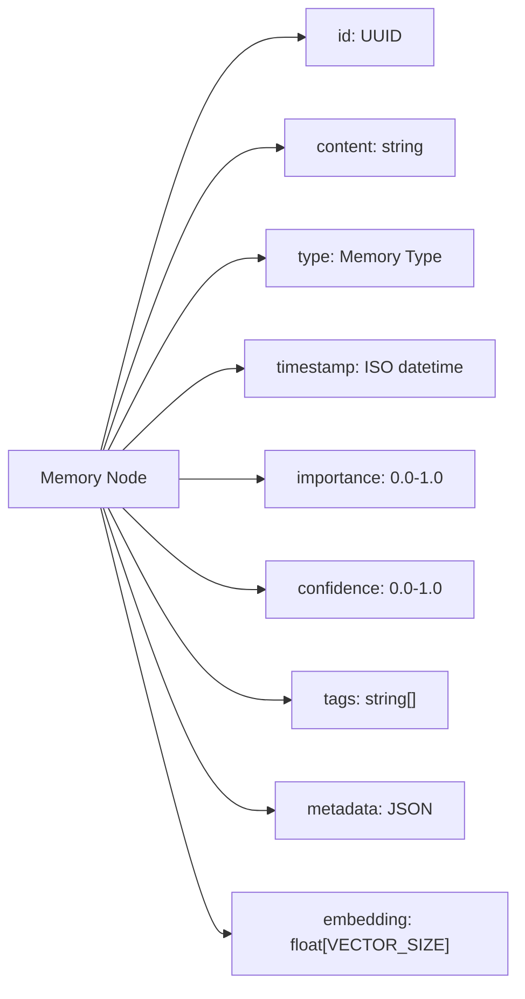
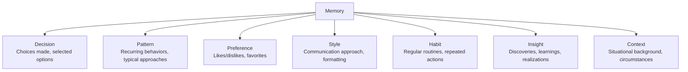
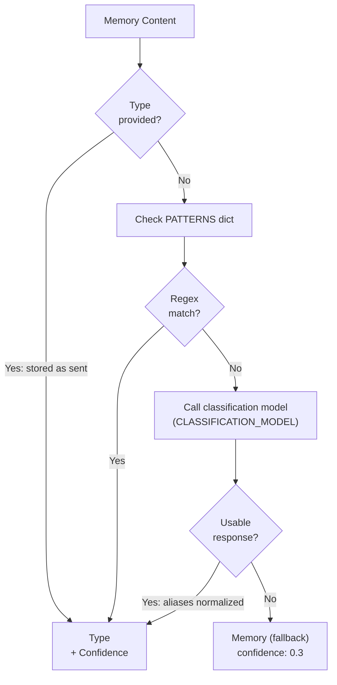
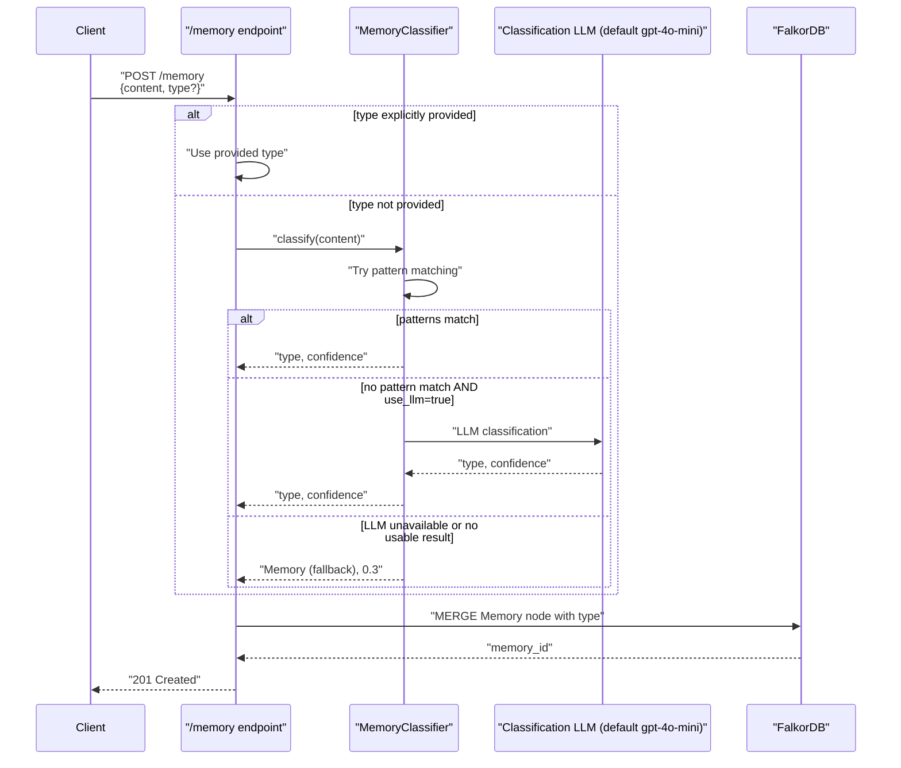
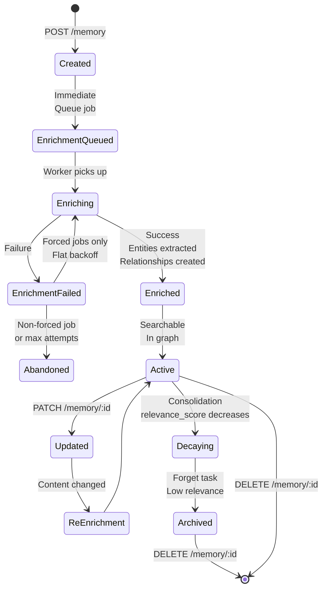
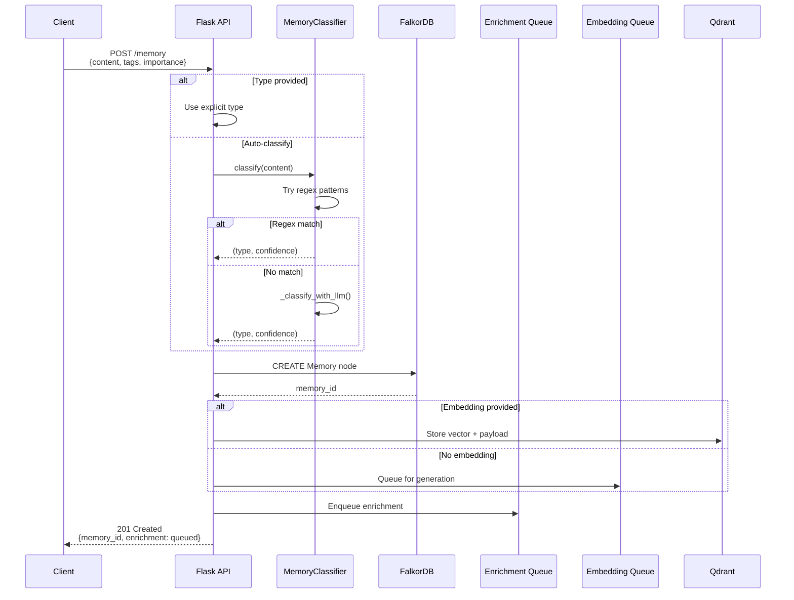

:::note[Source files]
Key implementation files:
- `automem/utils/validation.py` — Vector dimension validation
- `automem/classification/memory_classifier.py` — Classification system
- `automem/api/memory.py` — Memory lifecycle and storage
- [consolidation.py#L68-L79](https://github.com/verygoodplugins/automem/blob/5df0b83eb37a34b1206f89bf5d52190fe5a6ccdb/consolidation.py#L68-L79) — MemoryRow dataclass (normalized memory representation used by consolidation engine)
:::

This page describes the complete data model for memories in AutoMem, including their structure, properties, classification taxonomy, and storage representation. For information about how memories relate to each other, see [Relationship Types](/docs/core-concepts/relationship-types/). For details on how memories are searched and retrieved, see [Hybrid Search](/docs/core-concepts/hybrid-search/).

---

## Overview

Every memory in AutoMem is a structured data object with both required and optional properties. Memories are classified into specific types (Decision, Pattern, Preference, etc.), enriched with metadata, and stored redundantly in both FalkorDB (graph) and Qdrant (vector) databases. The memory model supports temporal validity windows, confidence scoring, and hierarchical tag organization.



---

## Memory Schema

### Core Properties

All memories contain the following properties:

| Property | Type | Required | Description |
|---|---|---|---|
| `id` | string (UUID) | Yes | Unique identifier, always generated server-side (an `id` sent in the request is ignored) |
| `content` | string | Yes | The actual memory text (minimum 1 character) |
| `type` | string | Yes | Classification from the `MEMORY_TYPES` set, or the `Memory` fallback. An explicit `type` in the request is stored as sent |
| `confidence` | float | Yes | Classification confidence score (0.0-1.0). Defaults to `0.9` when the request sets `type`; a `confidence` sent without `type` is ignored |
| `importance` | float | Yes | User-specified importance (0.0-1.0, default: 0.5) |
| `timestamp` | string (ISO 8601) | Yes | When the memory was created or occurred |
| `tags` | array[string] | No | Hierarchical categorization tags (e.g., `["project:automem", "decision"]`) |
| `tag_prefixes` | array[string] | No | Pre-computed lowercase tag prefixes for fast filtering |
| `metadata` | object | No | Flexible JSON object for custom fields |
| `embedding` | array[float] | No | Vector for semantic search. Its length is the effective `VECTOR_SIZE` (default 1024); while `VECTOR_SIZE_AUTODETECT` is on (the default), an existing Qdrant collection's dimension is adopted instead |

### Temporal Properties

| Property | Type | Required | Description |
|---|---|---|---|
| `t_valid` | string (ISO 8601) | No | When this memory becomes valid (future-dated memories). Defaults to `timestamp` |
| `t_invalid` | string (ISO 8601) | No | When this memory expires or becomes invalid |
| `updated_at` | string (ISO 8601) | Yes | Defaults to `timestamp` on creation. `PATCH /memory/:id` keeps the stored value unless the request sends `updated_at` |
| `last_accessed` | string (ISO 8601) | Yes | Last retrieval or access timestamp. Defaults to `updated_at` on creation |

### Enrichment Properties

| Property | Type | Description |
|---|---|---|
| `enriched_at` | string (ISO 8601) | When enrichment pipeline processed this memory |
| `summary` | string | Auto-generated summary (first sentence, max 240 chars) |
| `metadata.entities` | object | Extracted entities: `tools`, `projects`, `people`, `concepts`, `organizations`. Stored inside `metadata`, not as a top-level property |

### State Properties

| Property | Type | Description |
|---|---|---|
| `archived` | boolean | Whether memory is archived (excluded from search by default) |
| `relevance_score` | float | Dynamic score computed by consolidation engine |

---

## Memory Type Taxonomy

The classifier assigns one of seven semantic types, defined in `MEMORY_TYPES`. When it cannot classify a memory it returns the fallback type `Memory`, described below:

### Type Definitions



| Type | Description | Example Content |
|---|---|---|
| `Decision` | Strategic or technical choices, selected options | "Chose PostgreSQL over MongoDB for ACID compliance" |
| `Pattern` | Recurring behaviors, typical approaches, consistent tendencies | "Usually write integration tests before deploying" |
| `Preference` | Likes/dislikes, favorites, personal or team tastes | "Prefer async/await over callbacks for clarity" |
| `Style` | Communication approach, formatting preferences, tone | "Write commit messages in imperative mood" |
| `Habit` | Regular routines, repeated actions, scheduled activities | "Run pytest every morning before starting work" |
| `Insight` | Discoveries, learnings, realizations, key findings | "Realized embedding batching reduces costs by 40%" |
| `Context` | Situational background, circumstances, what was happening | "During database migration sprint in Q3 2024" |

:::caution
`"Memory"` is the fallback type returned by the classifier when no regex pattern matches and the LLM is unavailable or returns nothing usable (confidence: 0.3). It is not one of the seven canonical types, and `POST /memory` stores it as returned: nothing in the store path maps it to `"Context"`. `TYPE_ALIASES` normalizes the types the LLM returns, but the store path does not apply it, so a stored memory can carry `"Memory"`, and an explicit `type` in the request is stored exactly as sent.
:::

---

## Classification System

### Architecture

AutoMem employs a hybrid classification system that balances speed, cost, and accuracy:

1. **Explicit Type** (preferred): Client provides `type` field in POST request. It is stored as sent, with confidence `0.9` unless the request sets `confidence`
2. **Regex Pattern Matching** (fast, free): Checks content against predefined patterns
3. **LLM Fallback** (accurate): Uses the model in `CLASSIFICATION_MODEL` (default `gpt-4o-mini`) when patterns don't match

If the LLM is unavailable or returns nothing usable, the classifier returns `Memory` with confidence `0.3`.



### Pattern-Based Classification

The `MemoryClassifier` class defines regex patterns for each memory type:

| Type | Example Patterns |
|---|---|
| `Decision` | `r"decided to"`, `r"chose (\w+) over"`, `r"going with"`, `r"opted for"` |
| `Pattern` | `r"usually"`, `r"typically"`, `r"tend to"`, `r"often"`, `r"consistently"` |
| `Preference` | `r"prefer"`, `r"like.*better"`, `r"favorite"`, `r"rather than"` |
| `Style` | `r"wrote.*in.*style"`, `r"communicated"`, `r"formatted as"` |
| `Habit` | `r"\balways\b(?!\s+use\b)"`, `r"every time"`, `r"daily"`, `r"weekly"`, `r"routine"` |
| `Insight` | `r"realized"`, `r"discovered"`, `r"learned that"`, `r"figured out"` |
| `Context` | `r"during"`, `r"while working on"`, `r"in the context of"`, `r"when"` |

`always use` is a `Preference` pattern, so the `Habit` pattern skips it.

**Matching and Confidence:**

- Types are checked in the order listed above, and the first type with a matching pattern wins
- Base confidence: `0.6` when a single pattern of that type matches
- With more than one matching pattern for that type: `min(0.95, 0.6 + 0.1 × matches)`, so two matches give `0.8`, three give `0.9`, and four or more give `0.95`

### LLM Classification

When no regex pattern matches, the classifier falls back to the classification model (`CLASSIFICATION_MODEL`, default `gpt-4o-mini`):

**System Prompt Structure:**

```
You are a memory classification system. Classify each memory into exactly ONE of these types:
- Decision: Choices made, selected options, what was decided
- Pattern: Recurring behaviors, typical approaches, consistent tendencies
- Preference: Likes/dislikes, favorites, personal tastes
- Style: Communication approach, formatting, tone used
- Habit: Regular routines, repeated actions, schedules
- Insight: Discoveries, learnings, realizations, key findings
- Context: Situational background, what was happening, circumstances

Return JSON with: {"type": "<type>", "confidence": <0.0-1.0>}
```

**Request Format:**

- Model: `CLASSIFICATION_MODEL` (default `gpt-4o-mini`)
- Max tokens: `50`, sent as `max_completion_tokens` for model names starting with `o1`, `o3`, `o4`, `gpt-4o`, `gpt-4.1`, or `gpt-5` (which includes the default) and as `max_tokens` for other models
- Temperature: `0.3`, sent only with `max_tokens`, so the default model receives no temperature parameter
- Response format: JSON object
- Input limit: First 1000 characters of content

**Validation:**

- The returned type is normalized through `TYPE_ALIASES` (for example `analysis` becomes `Insight`, and a lowercase `decision` becomes `Decision`)
- A type that cannot be mapped is stored as `"Context"` with confidence `0.5`
- If the response omits `confidence`, `0.7` is used
- An empty response, invalid JSON, or an API error falls back to `"Memory"` with confidence `0.3`, and `"Memory"` is stored as returned
- While the enrichment circuit breaker is open, the LLM call is skipped with the same fallback. The breaker opens on an LLM quota error and stays open for `ENRICHMENT_CIRCUIT_COOLDOWN_SECONDS` (default `300`)

:::tip
Cost is approximately **$0.02/month** at 10 memories/day requiring LLM classification.
:::

The full classification sequence, including how POST /memory decides between explicit type, regex, and LLM:



---

## Temporal Validity Model

Memories support optional temporal validity windows:

### Validity Properties

| Property | Purpose | Use Case |
|---|---|---|
| `t_valid` | Earliest time this memory is valid | Future-dated reminders, scheduled knowledge |
| `t_invalid` | Latest time this memory is valid | Expiring credentials, time-bound decisions |

### Query Behavior

By default, `/recall` excludes memories where:

- `now < t_valid` (not yet valid)
- `now >= t_invalid` (expired)

**Override:** Pass `state_mode=history` (or the legacy `current_only=false`) to skip the [current-state filter](https://github.com/verygoodplugins/automem/blob/5df0b83eb37a34b1206f89bf5d52190fe5a6ccdb/automem/api/recall.py#L2301-L2314) and include not-yet-valid and expired memories. The filter also replaces a superseded memory (one with an active `INVALIDATED_BY` or `EVOLVED_INTO` replacement) with its replacement, so history mode returns the superseded memory itself. `/recall` [resolves `state_mode`](https://github.com/verygoodplugins/automem/blob/5df0b83eb37a34b1206f89bf5d52190fe5a6ccdb/automem/api/recall.py#L1853-L1866) to `current` when neither parameter is sent.

`time_query`, `start`, and `end` only set the time window; they do not include expired memories. The candidate searches skip archived memories in either mode (for example the [graph keyword search](https://github.com/verygoodplugins/automem/blob/5df0b83eb37a34b1206f89bf5d52190fe5a6ccdb/automem/search/runtime_recall_helpers.py#L635) and the [vector search](https://github.com/verygoodplugins/automem/blob/5df0b83eb37a34b1206f89bf5d52190fe5a6ccdb/automem/search/runtime_recall_helpers.py#L1012-L1013)).

**Example Scenarios:**

1. **Future-dated memory:** Set `t_valid` to a future date — the memory is not searchable until that date arrives.
2. **Expiring credential:** Set `t_invalid` to an expiry date — the memory is automatically excluded from search after that date.

---

## Metadata Structure

The `metadata` field is a flexible JSON object for storing arbitrary key-value pairs. Common patterns:

### Enrichment Metadata

Automatically added by the enrichment pipeline:

| Field | Type | Description |
|---|---|---|
| `metadata.entities` | object | Extracted entities by category |
| `metadata.enrichment` | object | Details of the latest enrichment run: `last_run`, `forced`, `temporal_links`, `patterns_detected`, `semantic_neighbors`. Just-in-time enrichment during recall adds `jit` and `jit_at` to the same object |

`enriched_at` and `summary` are top-level properties (see Enrichment Properties above), not `metadata` fields.

The `metadata.entities` object is structured by entity category:

```json
{
  "entities": {
    "tools": ["pytest", "docker"],
    "projects": ["automem"],
    "people": ["sarah"],
    "concepts": ["embedding", "vector search"],
    "organizations": ["OpenAI"]
  }
}
```

### Reserved Fields

The following fields are **reserved** and should not be placed in `metadata` (they are top-level properties):

- `type`, `confidence`, `content`, `timestamp`, `tags`, `tag_prefixes`
- `importance`, `embedding`, `id`, `archived`, `relevance_score`
- `t_valid`, `t_invalid`, `updated_at`, `last_accessed`

---

## Storage Representation

### FalkorDB (Graph Database)

Memories are stored as nodes with the `Memory` label. Node properties directly map to the memory schema:

**Graph Features:**

- Relationships connect memories (see [Relationship Types](/docs/core-concepts/relationship-types/))
- Cypher queries enable graph traversal
- Indexes on `tags`, `tag_prefixes`, `timestamp`, `importance`

### Qdrant (Vector Database)

Memories are stored as points with payloads mirroring FalkorDB properties:

**Qdrant Features:**

- Keyword indexes on `tags` and `tag_prefixes` for fast filtering
- HNSW index on vectors for approximate nearest neighbor search
- Payload filters support complex boolean queries

**Dual Storage Strategy:**

- FalkorDB is the **source of truth** (required)
- Qdrant is **optional** but enables semantic search
- Data is written to both databases synchronously
- Qdrant can rebuild FalkorDB if graph data is lost

:::note
If Qdrant is unavailable, the system gracefully degrades to graph-only search mode. Vector similarity scoring is disabled but keyword and graph traversal continue to work.
:::

---

## Memory Lifecycle



### Lifecycle Stages

1. **Created** (`POST /memory`):
   - Memory written to FalkorDB
   - Embedding queued for generation
   - Enrichment job queued
   - Returns `201 Created` immediately

2. **Enrichment Queued**:
   - Job added to in-memory queue
   - Worker thread blocks on the queue and wakes at least every `ENRICHMENT_IDLE_SLEEP_SECONDS` (default 2 seconds)
   - Up to `ENRICHMENT_MAX_ATTEMPTS` attempts (default 3), with a flat `ENRICHMENT_FAILURE_BACKOFF_SECONDS` sleep (default 5 seconds) before each re-enqueue
   - The re-enqueue goes through the in-flight duplicate check, which drops it for non-forced jobs (the kind `POST /memory` queues), so only forced jobs from `POST /enrichment/reprocess` are retried

3. **Enriching**:
   - Entity extraction (spaCy NER + regex)
   - Temporal links created (`OCCURRED_BEFORE`)
   - Semantic neighbors found (`SIMILAR_TO`)
   - Pattern detection (`EXEMPLIFIES`)
   - Summary generation (optional)

4. **Active**:
   - Fully searchable via `/recall`
   - Included in graph queries
   - Participates in consolidation

5. **Decaying**:
   - `relevance_score` decreases exponentially
   - Decay rate: daily consolidation task (default interval: 86400s)
   - Formula (simplified): `decay_factor = exp(-0.01 × age_days)`. Full score combines decay with access recency, relationship count, importance, and confidence: `relevance = decay_factor × (0.3 + 0.3 × access_factor) × relationship_factor × (0.5 + importance) × (0.7 + 0.3 × confidence)`, clamped to `[importance × 0.3, 1.0]`.

6. **Archived**:
   - Marked `archived: true`
   - Excluded from search by default
   - Can be restored or deleted

7. **Deleted**:
   - Removed from both FalkorDB and Qdrant
   - Relationships cleaned up
   - Irreversible operation

---

## Implementation Details

### Memory Creation Flow

The complete flow from client request through classification, storage, and queue submission:



---

## Validation Rules

### Content Validation

- **Minimum length:** 1 character (empty strings rejected)
- **Soft limit:** `MEMORY_CONTENT_SOFT_LIMIT` = 500 characters — content between 500–2000 chars triggers auto-summarization to a ~300 character target (when `MEMORY_AUTO_SUMMARIZE=true`)
- **Hard limit:** `MEMORY_CONTENT_HARD_LIMIT` = 2000 characters — content exceeding this is rejected with `400 Bad Request`
- **Encoding:** UTF-8

### Type Validation

- The classifier assigns one of: `Decision`, `Pattern`, `Preference`, `Style`, `Habit`, `Insight`, `Context`
- An explicit `type` is not checked: `POST /memory` and `POST /memory/batch` store whatever string the request sends, without rejecting unknown values or mapping them through `TYPE_ALIASES`, so send the canonical spelling

### Confidence Validation

- Range: `0.0` to `1.0` (inclusive)
- Default: `0.9` if type explicitly provided. Otherwise the classifier computes it and any `confidence` in the request is ignored
- Non-numeric values rejected

### Importance Validation

- Range: `0.0` to `1.0` (inclusive)
- Default: `0.5`
- Used in search ranking and consolidation

### Tag Validation

- Array of strings, or a single string that is stored as one tag (`POST /memory` does not split comma-separated strings). Any other type returns `400 Bad Request`
- `tags` are stored as sent, with case preserved and blank entries kept
- `tag_prefixes` are computed from the trimmed, lowercased tags, skipping blank entries
- Hierarchical prefixes auto-computed, splitting on `:` or `/` (e.g., `"project:automem:api"` → `["project", "project:automem", "project:automem:api"]`)
- `PATCH /memory/:id` and the enrichment pipeline use a different normalizer that splits comma-separated strings, trims entries, and drops blanks

### Timestamp Validation

- Must be ISO 8601 format
- Automatically converted to UTC with `+00:00` timezone
- Strings ending in `Z` converted to `+00:00`
- Invalid timestamps return `400 Bad Request`

### Embedding Validation

- Must match the effective vector dimension: `VECTOR_SIZE` (default `1024`), or the dimension of an existing Qdrant collection while `VECTOR_SIZE_AUTODETECT` (default `true`) adopts it
- Accepts a list of numbers or a comma-separated string; all values must be numeric
- On `POST /memory`, generated in the background if omitted and Qdrant is configured (otherwise `embedding_status` is `skipped`). With `EMBEDDING_PROVIDER=auto` (the default) the provider is the first available of Voyage (`VOYAGE_API_KEY`), OpenAI (`OPENAI_API_KEY`), Ollama (`OLLAMA_BASE_URL` or `OLLAMA_MODEL`), local FastEmbed, then a deterministic placeholder. See [Embedding Generation](/docs/architecture/embeddings/) for the other `EMBEDDING_PROVIDER` values
