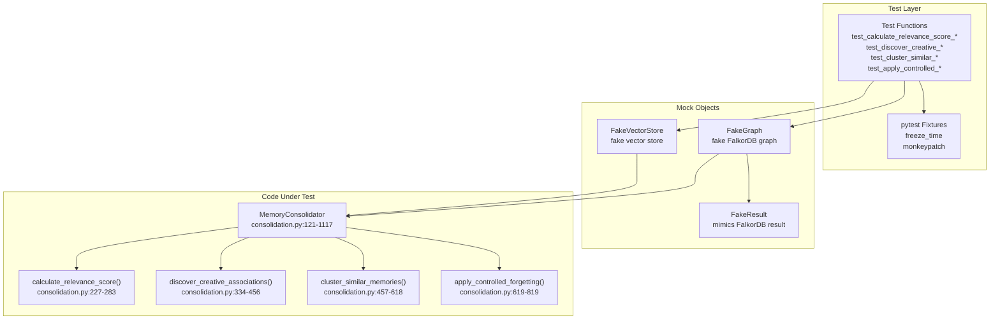
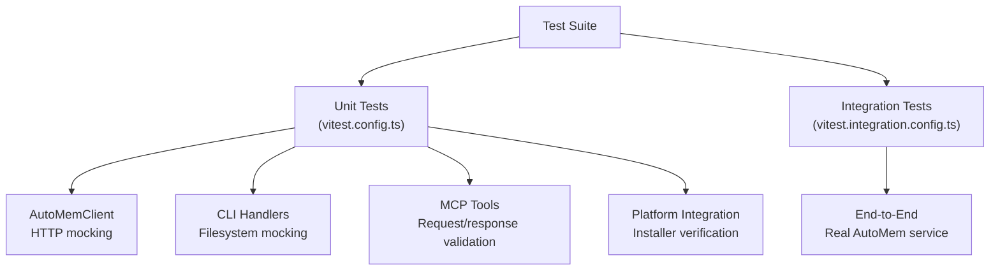

:::note[Two repositories]
AutoMem uses different test frameworks in each repository: **pytest** for the automem server (Python) and **Vitest** for the mcp-automem client (TypeScript).
:::

## AutoMem Server — Testing (pytest)

### Purpose and Scope

AutoMem's test suite validates core functionality through unit tests covering the Flask API, the consolidation engine, enrichment, and embedding providers. The test framework uses pytest with mock objects to isolate graph and vector store interactions, enabling fast execution without external dependencies.

The API endpoints have the largest share of tests (`test_api_endpoints.py`, `test_app.py`, and the route and error contracts in `tests/contracts/`), and the consolidation engine has its own mock-based suite. Background workers are only partly covered: the enrichment circuit breaker, `enrich_memory()`, batch embedding fallbacks, and the background sync check have unit tests, while `ConsolidationScheduler` has none.

### Test Suite Organization

```text
tests/
├── conftest.py
├── test_consolidation_engine.py
├── test_api_endpoints.py
├── test_app.py
├── test_backup_endpoint.py
├── test_enrichment.py
├── test_enrichment_circuit.py
├── test_embedding_providers.py
├── test_entity_identities.py
├── test_stream_events.py
├── test_integration.py
├── test_content_size.py
├── test_vector_size_safety.py
├── test_recall_entity_extraction.py
├── support/        # FakeGraph
├── contracts/      # route and error contract tests
├── lab/            # tests for the recall lab scripts in scripts/lab/
└── benchmarks/     # benchmark suites, auto-marked live
```

The tree shows the main files, not every module.

### Pytest Markers

Tests are tagged with markers to control which tier runs:

| Marker | Command | Requires | Purpose |
|---|---|---|---|
| `unit` | `pytest -m unit tests/` | No external services | Fast, isolated logic tests |
| `integration` | `AUTOMEM_RUN_INTEGRATION_TESTS=1 pytest -rs -m integration tests/` | Docker stack running | Full API + database flow |
| `live` | `pytest -m live tests/` | Benchmark setup | Benchmark suites under `tests/benchmarks/`, which are marked `live` automatically |

`make test` runs the unit tests (`pytest -rs -m unit`), then the MCP bridge's Node tests through `make test-node`. `make test-integration` starts Docker Compose and runs integration tests with `AUTOMEM_RUN_INTEGRATION_TESTS=1` and the test tokens set; without that variable the integration tests skip. `AUTOMEM_ALLOW_LIVE=1` is a separate switch that lets the integration tests run against a non-local `AUTOMEM_TEST_BASE_URL`.

#### Coverage by Component

| Component | Test File | Coverage Status |
|---|---|---|
| Memory Consolidation | `test_consolidation_engine.py` | Comprehensive |
| Decay Calculations | `test_consolidation_engine.py` | Covered |
| Creative Associations | `test_consolidation_engine.py` | Covered |
| Clustering Logic | `test_consolidation_engine.py` | Covered |
| Controlled Forgetting | `test_consolidation_engine.py` | Covered |
| Flask API Endpoints | `test_api_endpoints.py`, `test_app.py` | Covered |
| Enrichment Pipeline | `test_enrichment.py` | Covered |
| Embedding Providers | `test_embedding_providers.py` | Covered |
| Integration Flow | `test_integration.py` | Integration marker |
| Content Size Limits | `test_content_size.py` | Covered |
| Vector Size Safety | `test_vector_size_safety.py` | Covered |
| Recall Entity Extraction | `test_recall_entity_extraction.py` | Covered |
| MCP Bridge | `mcp-sse-server/test/server.test.js`, `mcp-sse-server/test/parity.test.js` | Covered (Node test runner; parity needs a live stack) |

### Running Tests

**Prerequisites** — install development dependencies:

```bash
pip install -r requirements-dev.txt
```

**Basic execution:**

```bash
pytest -m unit tests/                            # Run unit tests (no external services)
pytest -m unit tests/ -v                         # Verbose output
pytest tests/test_consolidation_engine.py        # Specific file
pytest -m unit tests/ -k "test_relevance_score"  # Specific function
AUTOMEM_RUN_INTEGRATION_TESTS=1 pytest -rs -m integration tests/  # Integration tests (requires Docker stack)
```

**MCP bridge:** the bridge's tests use Node's built-in test runner. `make test-node` (or `npm test` inside `mcp-sse-server/`, which runs `node --test`) runs them, `make test` runs them after the unit tests, and AutoMem's CI `node-test` job runs them on Node 20. The three tests in `parity.test.js` skip unless `AUTOMEM_RUN_PARITY_TESTS=1` is set, and when enabled they need a live stack. `make test-parity` starts its own Docker stack on port 8011 and runs the bridge tests with that variable set, which diffs the remote bridge against the stdio `mcp-automem` transport.

### Test Architecture



### Mock Object Implementation

The test suite uses in-memory mock objects that implement the same protocols as production dependencies, enabling fast tests without FalkorDB or Qdrant instances.

#### `FakeGraph` Class

`FakeGraph` simulates FalkorDB query behavior ([tests/support/fake_graph.py:57-899](https://github.com/verygoodplugins/automem/blob/5df0b83eb37a34b1206f89bf5d52190fe5a6ccdb/tests/support/fake_graph.py#L57-L899)):

- **Query pattern matching**: Uses string matching to identify query type (e.g., `"COUNT(DISTINCT r)"` for relationship counts)
- **Deterministic responses**: Returns pre-configured data from state attributes
- **Side effect tracking**: Records deletions in `graph.deleted` (a list of memory IDs), and archives and score updates in `graph.archived` and `graph.updated_scores` (lists of `(memory_id, score)` tuples)
- **Query history**: Records every call in `graph.queries` as a `(query, params)` tuple for verification

#### `FakeVectorStore` Class

`FakeVectorStore` records each `delete()` call as a `(collection_name, points_selector)` tuple in `vector_store.deletions` ([tests/test_consolidation_engine.py:19-24](https://github.com/verygoodplugins/automem/blob/5df0b83eb37a34b1206f89bf5d52190fe5a6ccdb/tests/test_consolidation_engine.py#L19-L24)).

#### `FakeResult` Class

`FakeResult` mimics FalkorDB query result structure with a `result_set` attribute ([tests/support/fake_graph.py:9-11](https://github.com/verygoodplugins/automem/blob/5df0b83eb37a34b1206f89bf5d52190fe5a6ccdb/tests/support/fake_graph.py#L9-L11)).

### Test Fixtures

#### `freeze_time` Fixture

The `freeze_time` fixture uses `monkeypatch` to replace `datetime.now()` with a fixed timestamp (2024-01-01 00:00:00 UTC), ensuring deterministic decay calculations ([tests/test_consolidation_engine.py:27-39](https://github.com/verygoodplugins/automem/blob/5df0b83eb37a34b1206f89bf5d52190fe5a6ccdb/tests/test_consolidation_engine.py#L27-L39)):

- **Auto-use**: Applies to all tests automatically
- **Module patching**: Patches `consolidation_module.datetime`, not global `datetime`
- **Timezone support**: Handles both naive and aware datetime calls
- **Cleanup**: Automatically restores original `datetime` after each test

#### Helper Functions

`iso_days_ago(days: int)` generates ISO timestamp strings relative to the same 2024-01-01 UTC base as the frozen time ([tests/test_consolidation_engine.py:42-44](https://github.com/verygoodplugins/automem/blob/5df0b83eb37a34b1206f89bf5d52190fe5a6ccdb/tests/test_consolidation_engine.py#L42-L44)):

```python
def iso_days_ago(days: int) -> str:
    base = datetime(2024, 1, 1, tzinfo=timezone.utc)
    return (base - timedelta(days=days)).isoformat()
```

### Writing New Tests

#### Test Function Structure

Follow this pattern for consolidation engine tests:

1. **Setup**: Create `FakeGraph` and configure mock data
2. **Execution**: Instantiate `MemoryConsolidator` and call method
3. **Verification**: Assert return values and check mock state

`calculate_relevance_score()` takes one memory dict (plus an optional `current_time`), not separate keyword arguments. It requires the dict's `id` and reads `timestamp`, `last_accessed`, `importance`, and `confidence` from it:

```python
def test_calculate_relevance_score_recent_memory():
    # 1. Setup
    graph = FakeGraph()
    graph.relationship_counts = {"mem_001": 3}

    # 2. Execution
    consolidator = MemoryConsolidator(graph=graph, vector_store=FakeVectorStore())
    score = consolidator.calculate_relevance_score(
        {
            "id": "mem_001",
            "timestamp": iso_days_ago(2),
            "last_accessed": iso_days_ago(1),
            "importance": 0.8,
            "confidence": 0.7,
        }
    )

    # 3. Verification
    assert 0.5 < score < 1.0  # Recent, high-importance memory
```

#### Mock Data Configuration

**Relationship counts** — control `_get_relationship_count()` return values:

```python
graph.relationship_counts = {
    "mem_001": 5,  # 5 relationships
    "mem_002": 0   # No relationships
}
```

The row fixtures (`sample_rows`, `cluster_rows`, `decay_rows`, and `forgetting_rows`) are plain lists of column values in the order the matching Cypher query returns them, not dicts.

**Sample memories for creative associations** — configure `sample_rows` as `[id, content, type, embedding, timestamp]`, matching the query in `discover_creative_associations()`:

```python
graph.sample_rows = [
    ["mem_001", "Chose PostgreSQL for reliability", "Decision", [1.0, 0.0, 0.0], iso_days_ago(3)],
    ["mem_002", "Prefer typed languages", "Preference", [0.0, 1.0, 0.0], iso_days_ago(4)],
]
```

**Cluster data** — configure `cluster_rows` as `[id, content, embedding, type]` for clustering tests. These rows feed the graph-embedding fallback in `cluster_similar_memories()`, which runs when the consolidator has no vector store. With a vector store attached, the consolidator reads embeddings from Qdrant instead. Clusters need at least `min_cluster_size` rows (3 by default):

```python
graph.cluster_rows = [
    ["mem_001", "content_a", [0.1, 0.2, 0.3], "Insight"],
    ["mem_002", "content_b", [0.15, 0.22, 0.31], "Insight"],
    ["mem_003", "content_c", [0.12, 0.21, 0.29], "Pattern"],
]
```

**Decay data** — configure `decay_rows` as `[id, content, timestamp, importance, last_accessed, old_score]`, the column order `_apply_decay()` selects (`old_score` is the previously stored `relevance_score`):

```python
graph.decay_rows = [
    ["mem_001", "Early note", iso_days_ago(60), 0.8, iso_days_ago(30), 0.75],
    ["mem_002", "Recent insight", iso_days_ago(1), 0.7, iso_days_ago(1), 0.9],
]
```

**Forgetting data** — configure `forgetting_rows` as `[id, content, score, timestamp, type, importance, last_accessed]` for `apply_controlled_forgetting()`. Optional `protected` and `protected_reason` columns may follow:

```python
graph.forgetting_rows = [
    # Deleted: very low relevance and past the grace period
    ["mem_001", "Superseded note", 0.01, iso_days_ago(365), "Memory", 0.1, iso_days_ago(365)],
    # Archived: low relevance, past the grace period
    ["mem_002", "Memory to archive", 0.1, iso_days_ago(100), "Memory", 0.1, iso_days_ago(100)],
    # Kept: low relevance, but inside the 90-day grace period, so only its score is updated
    ["mem_003", "Recent low-value note", 0.1, iso_days_ago(15), "Memory", 0.1, iso_days_ago(15)],
]
```

#### Testing Dry Run vs Execution

Many consolidation methods support a `dry_run` parameter. Test both modes:

```python
def test_apply_forgetting_dry_run():
    graph = FakeGraph()
    # ... configure graph ...
    consolidator = MemoryConsolidator(graph=graph, vector_store=FakeVectorStore())
    result = consolidator.apply_controlled_forgetting(dry_run=True)
    assert graph.deleted == []  # Nothing deleted in dry run

def test_apply_forgetting_execution():
    graph = FakeGraph()
    # ... configure graph with low-relevance memories ...
    vector_store = FakeVectorStore()
    consolidator = MemoryConsolidator(graph=graph, vector_store=vector_store)
    result = consolidator.apply_controlled_forgetting(dry_run=False)
    assert len(graph.deleted) > 0           # Nodes deleted
    assert len(vector_store.deletions) > 0  # Vector deletions issued
```

#### Verifying Mock Interactions

**Query history** — `graph.queries` holds `(query, params)` tuples, so match on the first element:

```python
assert any("MATCH (m:Memory)" in query for query, _params in graph.queries)
```

**State changes** — `graph.deleted` is a list of memory IDs, while `graph.archived` and `graph.updated_scores` are lists of `(memory_id, score)` tuples:

```python
assert "mem_001" in graph.deleted
assert any(memory_id == "mem_002" for memory_id, _score in graph.archived)
assert dict(graph.updated_scores)["mem_003"] < 0.2
```

**Vector store interactions** — `vector_store.deletions` holds `(collection_name, points_selector)` tuples. When the Qdrant models can't be imported, as under the test suite's `qdrant_client` stub, the consolidator passes a plain `{"points": [...]}` dict as the selector. The repository's own test accepts either `point_ids` or `points`:

```python
collection, selector = vector_store.deletions[0]
assert collection == "memories"
points = selector.get("point_ids") or selector.get("points")
assert points == ["mem_001"]
```

### Test Coverage Report

#### Consolidation Engine Coverage

| Module | Function | Test Coverage |
|---|---|---|
| `MemoryConsolidator` | `calculate_relevance_score()` | Complete |
| `MemoryConsolidator` | `discover_creative_associations()` | Complete |
| `MemoryConsolidator` | `cluster_similar_memories()` | Complete |
| `MemoryConsolidator` | `apply_controlled_forgetting()` | Complete (dry run + execution) |
| `MemoryConsolidator` | `_apply_decay()` | Complete |
| `MemoryConsolidator` | `consolidate()` | Partial (individual steps tested) |
| `ConsolidationScheduler` | — | Not tested |

#### Uncovered Components

**MCP Bridge** — `make test` and AutoMem's CI `node-test` job skip the three parity tests in `parity.test.js`. Cross-transport parity runs through `make test-parity` and the `MCP Transport Parity` workflow (`.github/workflows/mcp-parity.yml`), which runs on pull requests that touch `mcp-sse-server/**`, `automem/api/**`, or `app.py`. That workflow is `continue-on-error` while the harness still fails on known parity gaps, so a parity failure does not block a pull request.

### Performance Testing Procedures

Based on the current batching and logging implementation:

**Embedding batching verification** — rapidly create 25 memories and check logs:

```bash
for i in {1..25}; do
  curl -X POST http://localhost:8001/memory \
    -H "Authorization: Bearer $TOKEN" \
    -d "{\"content\": \"Memory $i\", \"tags\": [\"test\"]}"
done
```

Expected log: a batch embedding log line from the embedding provider

**Consolidation performance** — monitor logs during decay runs. After optimization, should see ~80% reduction in relationship query counts.

**Health endpoint** — verify enrichment stats:

```bash
curl http://localhost:8001/health | jq '.enrichment'
# Expected keys: status, queue_depth, pending, inflight, processed, failed
```

**Structured logging** — check logs for structured events after memory operations:

- `recall_complete` events with latency metrics
- `memory_stored` events with queue status

### Future Testing Priorities

Based on current coverage gaps:

1. **Background worker tests** — Test enrichment and embedding workers
2. **Integration tests** — Test full memory storage → enrichment → recall flow
3. **ConsolidationScheduler tests** — Test scheduling logic and intervals
4. **Load testing** — Verify performance under high memory throughput

---

## mcp-automem Client — Testing (Vitest)

### Overview

The mcp-automem package uses Vitest as its test runner, providing fast ES module support, built-in coverage reporting, watch mode for TDD, and parallel test execution.

### Test Organization



- **Unit tests**: `src/**/*.test.ts` and `tests/**/*.test.ts` — stub the global `fetch` for HTTP requests, mock `fs` for filesystem operations, use in-memory fixtures for AutoMem responses
- **Integration tests**: `tests/integration/automem-service.test.ts` — requires a running AutoMem service. `vitest.config.ts` excludes this file from the unit run, and `vitest.integration.config.ts` runs only this file. The other file in that directory, `mcp-tools.test.ts`, needs no service and runs with the unit tests.

### Test Commands

| Script | Command | Purpose |
|---|---|---|
| `test` | `vitest run` | Run all unit tests once |
| `test:watch` | `vitest` | Watch mode for TDD |
| `test:coverage` | `vitest run --coverage` | Generate coverage reports |
| `test:integration` | `vitest run --config vitest.integration.config.ts` | Integration test suite |
| `test:all` | Both unit and integration | Full test suite |

### Coverage Requirements

Coverage reporting is integrated into the CI pipeline via `@vitest/coverage-v8`, generating reports for line, branch, function, and statement coverage. Coverage failures don't block builds (`continue-on-error: true`) — coverage is informational rather than a hard gate during active development.

### Mock Strategy

**HTTP mocking** — `AutoMemClient` calls the global `fetch`, so stub it to simulate AutoMem backend responses without a running service:

```typescript
import { vi } from 'vitest';

const mockFetch = vi.fn();
vi.stubGlobal('fetch', mockFetch);

mockFetch.mockResolvedValueOnce({
  ok: true,
  json: async () => ({ memory_id: 'mem-123', message: 'Memory stored' }),
});
```

**Filesystem mocking** — mock `fs` for CLI installer tests:

```typescript
vi.mock('fs', () => ({
  writeFileSync: vi.fn(),
  readFileSync: vi.fn().mockReturnValue('template content'),
  existsSync: vi.fn().mockReturnValue(false)
}));
```

**In-memory AutoMem fixtures** — use realistic response shapes:

```typescript
const mockRecallResponse = {
  results: [
    {
      id: 'mem-001',
      content: 'Chose PostgreSQL for reliability',
      score: 0.92,
      tags: ['decision', 'database'],
      importance: 0.8,
      metadata: { type: 'Decision' }
    }
  ],
  count: 1
};
```

### Integration Test Requirements

Integration tests require a live AutoMem service. Set the following environment variable before running (the default is shown):

```bash
AUTOMEM_TEST_API_URL=http://localhost:8001
```

`AUTOMEM_TEST_ENDPOINT` is the deprecated alias and is still read as a fallback. The suite builds its client from the endpoint alone and sends no API key.

:::caution[Integration tests create real data]
Integration tests store and recall actual memories in the AutoMem service. Use a dedicated test instance or clean up test memories after runs using tag-based deletion.
:::

### CI/CD Integration

The CI workflow ([`.github/workflows/ci.yml`](https://github.com/verygoodplugins/mcp-automem/blob/9a0bbf754dd31db524da25638b0e97907e32ff37/.github/workflows/ci.yml)) runs on every PR and push to main, as three jobs.

**Check Links** (`links`) validates links in `README.md`, `INSTALLATION.md`, and `CHANGELOG.md` with lychee (fails build on broken links).

**`test`** runs on Ubuntu with Node 24. After `npm ci`, its steps run in this order:

1. `npm run format:check` — Prettier (fails build on formatting differences)
2. `npm run lint` — ESLint (fails build on errors)
3. `npm run build` — TypeScript compilation (fails build on errors)
4. `npm test` — Unit tests (fails build on failures)
5. `npm run test:coverage` — Coverage report (non-blocking)
6. `npm run test:e2e` — Headless installer end-to-end scenarios: it builds and packs a tarball and runs install and uninstall scenarios against an in-process mock (fails build on failures). A preceding step checks out `verygoodplugins/automem-website` so the harness can run its `public/install.sh` bootstrap scenario.

**Hook commands** (`hooks-windows`) runs on Windows. It builds the package, then runs `tests/installer/hook-commands.test.ts` with Vitest.

Unit tests run in CI without an external AutoMem service. Integration tests are run manually or in dedicated integration environments.
