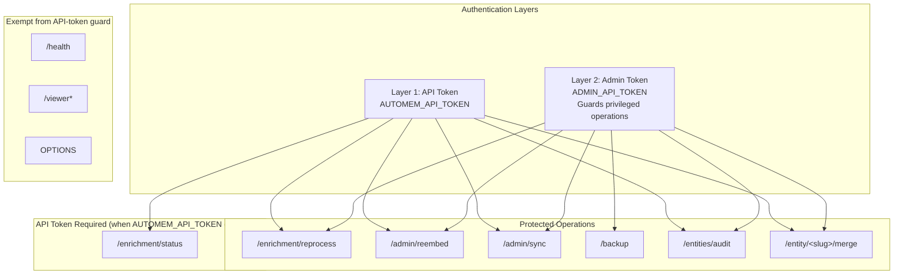
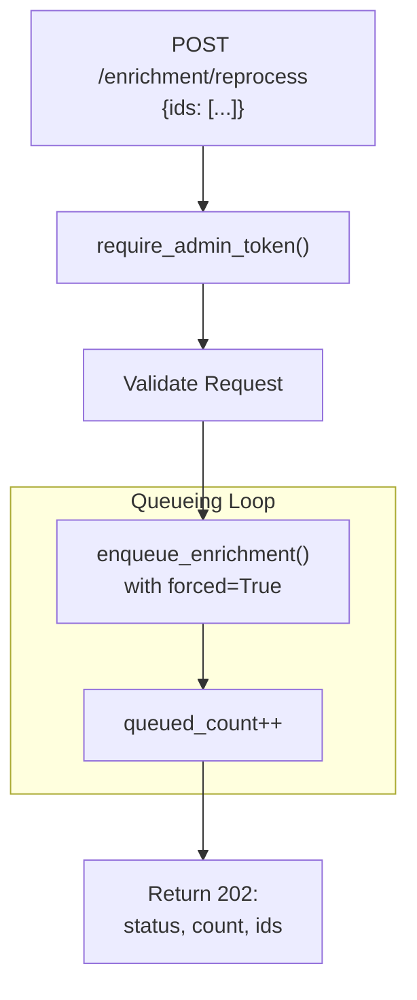
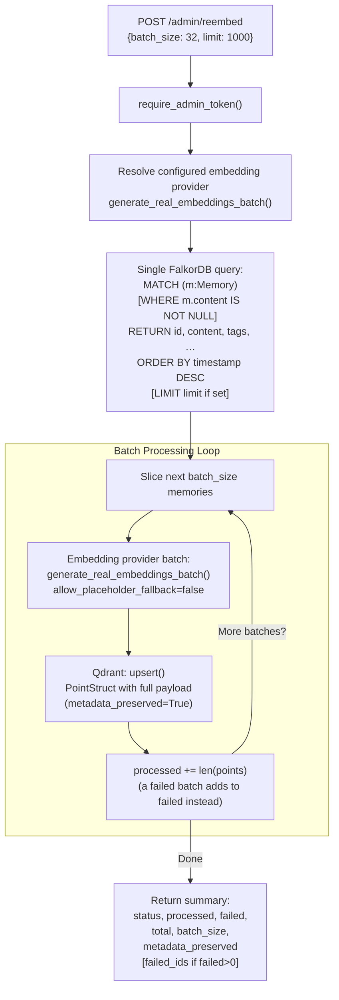

:::note[Source files]
- [app.py](https://github.com/verygoodplugins/automem/blob/5df0b83eb37a34b1206f89bf5d52190fe5a6ccdb/app.py#L273-L289) — API-token exemptions
- [app.py](https://github.com/verygoodplugins/automem/blob/5df0b83eb37a34b1206f89bf5d52190fe5a6ccdb/app.py#L480-L489) — HTTP error responses
- [automem/api/admin.py](https://github.com/verygoodplugins/automem/blob/5df0b83eb37a34b1206f89bf5d52190fe5a6ccdb/automem/api/admin.py#L61-L378) — Admin endpoints
- [automem/api/enrichment.py](https://github.com/verygoodplugins/automem/blob/5df0b83eb37a34b1206f89bf5d52190fe5a6ccdb/automem/api/enrichment.py#L37-L67) — Enrichment endpoints
- [automem/api/backup.py](https://github.com/verygoodplugins/automem/blob/5df0b83eb37a34b1206f89bf5d52190fe5a6ccdb/automem/api/backup.py#L39-L42) — `/backup` export endpoint
- [automem/api/entity.py](https://github.com/verygoodplugins/automem/blob/5df0b83eb37a34b1206f89bf5d52190fe5a6ccdb/automem/api/entity.py#L316-L456) — Entity audit and merge endpoints
:::

Administrative endpoints require elevated privileges (`ADMIN_API_TOKEN`) for managing enrichment processing, embedding generation, and entity cleanup. These operations are intended for maintenance, debugging, and bulk data operations.

For standard memory operations (store, recall, update, delete), see [Memory Operations](/docs/reference/api/memory-operations/). For consolidation scheduling, see [Consolidation Operations](/docs/reference/api/consolidation/).

---

## Authentication Model

Most privileged admin operations require **dual authentication**:

1. **Standard API Token** (`AUTOMEM_API_TOKEN`) — Required by the global API-token guard except for `/health`, `/backup`, `/viewer*`, and `OPTIONS` requests
2. **Admin Token** (`ADMIN_API_TOKEN`) — Additional token for privileged operations

`/backup` is the admin-only exception: it bypasses the API-token guard but still requires the admin token.

### Authentication Methods

| Token Type | Header Methods | Query Parameter | Environment Variable |
|------------|---------------|-----------------|---------------------|
| **API Token** | `Authorization: Bearer <token>` / `X-API-Key: <token>` | `?api_key=<token>` | `AUTOMEM_API_TOKEN` |
| **Admin Token** | `X-Admin-Token: <token>` / `X-Admin-Api-Key: <token>` | `?admin_token=<token>` | `ADMIN_API_TOKEN` |

### Endpoint Authentication Requirements



### Error Responses

Authentication failures and other errors raised through Flask's HTTP exception path use this envelope. Endpoint-specific failures can return their own response bodies, so do not assume it applies to every error response.

| Status Code | Response | Meaning |
|-------------|----------|---------|
| `401` | `{"status": "error", "code": 401, "message": "Unauthorized"}` | Missing or invalid `AUTOMEM_API_TOKEN` |
| `401` | `{"status": "error", "code": 401, "message": "Admin authorization required"}` | Missing or invalid `ADMIN_API_TOKEN` |
| `403` | `{"status": "error", "code": 403, "message": "Admin token not configured"}` | Server has no `ADMIN_API_TOKEN` environment variable set |
| `503` | `{"status": "error", "code": 503, "message": "Embedding provider is not configured"}` | Returned only when the batch-embedding callable is absent, not when no real provider is configured. The stock server (`app.py`) always binds that callable, so this 503 is effectively unreachable there: a missing or placeholder provider returns HTTP `200` `complete` with every memory in `failed` (see Phase 2 under `POST /admin/reembed`). `/admin/sync` checks only when some memories need embedding, so `dry_run` and `already_synced` responses are unaffected |
| `503` | `{"status": "error", "code": 503, "message": "Qdrant is not available - cannot store embeddings"}` | Qdrant is unavailable for `/admin/reembed` or `/admin/sync`. `/admin/sync` uses the shorter message `Qdrant is not available` |
| `503` | `{"status": "error", "code": 503, "message": "FalkorDB is unavailable"}` | FalkorDB is unavailable for `/admin/reembed` or `/admin/sync` |

---

## GET /enrichment/status

**Authentication:** API token (when `AUTOMEM_API_TOKEN` is configured)

**Purpose:** Monitor the enrichment pipeline's health and processing statistics. Unlike `/health`, this endpoint is protected by the global API token guard whenever `AUTOMEM_API_TOKEN` is set.

### Response Schema

```json
{
  "status": "running",
  "queue_size": 3,
  "pending": 2,
  "inflight": 1,
  "max_attempts": 3,
  "stats": {},
  "classification": {},
  "circuit": {
    "open": false,
    "circuit_open_skips": 0,
    "recoveries": 0
  }
}
```

### Status Values

| Field | Type | Description |
|-------|------|-------------|
| `status` | string | `"running"` if enrichment worker is active, `"stopped"` if worker thread is dead |
| `queue_size` | integer | Current number of jobs in the enrichment queue |
| `pending` | integer | Count of memories waiting to be processed |
| `inflight` | integer | Count of memories currently being processed |
| `max_attempts` | integer | Maximum attempts for a forced job before giving up; non-forced jobs are not retried (from `ENRICHMENT_MAX_ATTEMPTS`) |
| `stats` | object | Lifetime enrichment statistics (nested object with processing counters) |
| `classification` | object | Classification service counters (LLM vs regex usage statistics) |
| `circuit` | object | LLM quota circuit-breaker state: `open` (`true` while the cooldown is running), `circuit_open_skips` (LLM calls skipped because the circuit was open or a recovery probe was already running), and `recoveries` (recovery probes that succeeded and closed the circuit) |

The circuit breaker covers the LLM calls made for memory classification and auto-summarization. A quota error from the LLM opens it, and those calls are skipped for `ENRICHMENT_CIRCUIT_COOLDOWN_SECONDS` (default `300`). After the cooldown one recovery probe call is allowed. A successful probe closes the circuit and increments `recoveries`; another quota error restarts the cooldown. A probe that fails with any other error, such as an unavailable OpenAI client, also closes the circuit but does not increment `recoveries`.

### Example Usage

```bash
curl "https://your-automem-instance/enrichment/status" \
  -H "Authorization: Bearer YOUR_API_TOKEN"
```

### Troubleshooting with Status

| Observation | Likely Cause | Action |
|-------------|-------------|--------|
| `status: "stopped"` | Worker thread crashed | Check application logs for exceptions, restart service |
| `queue_size` increasing | Worker processing slower than intake | Monitor `inflight`, check for spaCy or OpenAI issues |
| High failure count in `stats` | Enrichment logic errors | Review application logs, check Qdrant connectivity |
| `inflight` stuck | Worker deadlocked | Restart enrichment worker or service |

---

## POST /enrichment/reprocess

**Authentication:** API token + Admin token

**Purpose:** Force re-enrichment of specific memories. Useful after:
- Updating enrichment logic or configuration
- Adding spaCy model capabilities
- Fixing corrupted enrichment metadata
- Recovering from systematic enrichment failures

### Request Schema

| Parameter | Type | Required | Description |
|-----------|------|----------|-------------|
| `ids` | array[string] \| string | **Yes** | Memory UUIDs to reprocess. Provide a non-empty array or comma-separated string in the JSON body; `?ids=` is used when the body has no `ids` value. |

The handler trims and deduplicates IDs before queueing each one with `forced=True`, so repeated IDs in a request collapse to one queued ID and an already pending or in-flight ID can be requeued.

### Example Request

```bash
curl -X POST https://your-automem-instance/enrichment/reprocess \
  -H "Authorization: Bearer YOUR_API_TOKEN" \
  -H "X-Admin-Token: YOUR_ADMIN_TOKEN" \
  -H "Content-Type: application/json" \
  -d '{
    "ids": [
      "a1b2c3d4-e5f6-7890-abcd-ef1234567890",
      "b2c3d4e5-f6a7-8901-bcde-f12345678901"
    ]
  }'
```

### Response Schema (HTTP 202 Accepted)

| Field | Type | Description |
|-------|------|-------------|
| `status` | string | Always `"queued"` |
| `count` | integer | Number of distinct UUIDs queued; not a success/failure count |
| `ids` | array[string] | Deduplicated memory UUIDs queued, sorted lexicographically |

```json
{
  "status": "queued",
  "count": 2,
  "ids": [
    "a1b2c3d4-e5f6-7890-abcd-ef1234567890",
    "b2c3d4e5-f6a7-8901-bcde-f12345678901"
  ]
}
```

### Processing Flow



### Implementation Details

The reprocessing operation performs these steps:

1. **Validation Phase** — Validates that the `ids` array is non-empty
2. **Queueing** — Calls `enqueue_enrichment(memory_id, forced=True)` which:
   - Acquires `state.enrichment_lock`
   - Adds memory ID to `state.enrichment_pending`
   - Puts an `EnrichmentJob` with `forced=True` in queue
3. **Background Processing** — The `enrichment_worker()` thread picks up jobs and calls `enrich_memory()` which:
   - Extracts entities via spaCy (if installed)
   - Creates temporal `PRECEDED_BY` edges
   - Finds semantic neighbors via Qdrant
   - Creates `SIMILAR_TO` relationships
   - Detects patterns and creates `EXEMPLIFIES` edges
   - Updates `metadata.enriched_at` timestamp

---

## POST /admin/reembed

**Authentication:** API token + Admin token

**Purpose:** Regenerate embeddings for all memories in batches. Critical for:
- Migrating to a different embedding model
- Recovering from Qdrant data loss
- Fixing corrupted embeddings
- Bulk embedding generation after initial import

### Request Schema

| Parameter | Type | Required | Description |
|-----------|------|----------|-------------|
| `batch_size` | integer | No | Memories per embedding-provider batch call. Default: `32`. Max: `100` |
| `limit` | integer | No | Max memories to process. If omitted, processes all memories in database |
| `force` | boolean | No | Omits the `WHERE m.content IS NOT NULL` filter from the enumeration query. The endpoint never checks Qdrant for existing vectors, so every selected memory is re-embedded with or without `force`. Rows with null or empty content are still skipped, so without `limit` it selects the same memories as `false`. With `limit`, rows with null content count toward `limit` before they are skipped. Default: `false` |

### Example Request

```bash
curl -X POST https://your-automem-instance/admin/reembed \
  -H "Authorization: Bearer YOUR_API_TOKEN" \
  -H "X-Admin-Token: YOUR_ADMIN_TOKEN" \
  -H "Content-Type: application/json" \
  -d '{"batch_size": 32}'
```

### Processing Architecture



### Response Schema

| Field | Type | Description |
|-------|------|-------------|
| `status` | string | Result status |
| `processed` | integer | Number of memories successfully re-embedded |
| `failed` | integer | Number of memories that failed re-embedding |
| `total` | integer | Number of memories selected for re-embedding: rows returned by the query (up to `limit`) that have non-empty content |
| `batch_size` | integer | Batch size used (from request or default 32) |
| `metadata_preserved` | boolean | Whether existing metadata was preserved during re-embedding |
| `failed_ids` | array[string] | *(Conditional)* Up to 10 memory IDs that failed re-embedding; only present when `failed > 0` |
| `failed_ids_truncated` | boolean | *(Conditional)* `true` when more than 10 IDs failed and `failed_ids` was cut to the first 10; omitted otherwise |

```json
{
  "status": "complete",
  "processed": 1000,
  "failed": 0,
  "total": 1000,
  "batch_size": 32,
  "metadata_preserved": true
}
```

When no memory has content to embed, the endpoint returns early with a smaller response. `failed`, `batch_size`, and `metadata_preserved` are absent:

```json
{
  "status": "complete",
  "message": "No memories found to reembed",
  "processed": 0,
  "total": 0
}
```

### Implementation Details

**Phase 1: Memory Enumeration and Content Fetch**

Fetches all memory data (or up to `limit`) in a single FalkorDB query:
```cypher
MATCH (m:Memory)
WHERE m.content IS NOT NULL
RETURN m.id AS id, m.content AS content, m.tags AS tags,
       m.importance AS importance, m.timestamp AS timestamp,
       m.type AS type, m.confidence AS confidence,
       m.metadata AS metadata, m.updated_at AS updated_at,
       m.last_accessed AS last_accessed
ORDER BY m.timestamp DESC
-- When the `limit` request parameter is set, a LIMIT clause is appended after this line
```

When `force=true`, the `WHERE m.content IS NOT NULL` filter is omitted from the query. However, the Python collection loop still checks `if content:` before adding a row to the processing list, so memories with null or empty content are excluded regardless of `force`. There is no separate per-batch content retrieval step — all memory data is loaded upfront.

**Phase 2: Embedding Provider Batch Generation**

Tries one provider batch call per batch via `generate_real_embeddings_batch(..., allow_placeholder_fallback=False)`. If that call raises, or returns the wrong number of vectors or the wrong dimensions, the helper discards the result and retries the batch one item at a time with single-input calls, never substituting placeholder vectors. With a real provider, the batch fails only if one of those item calls fails. With no provider, or with the placeholder provider (which the default `EMBEDDING_PROVIDER=auto` falls back to when no real provider initializes), the helper raises before any provider call, so there is no retry and every batch fails immediately. Uses whichever provider is configured (`EMBEDDING_PROVIDER`, Voyage, OpenAI, Ollama, FastEmbed, etc.) — not hard-coded to OpenAI. Returns **503** only when the embedding callable is absent or Qdrant/FalkorDB is unavailable before processing starts. Placeholder-only or other provider failures raised during batch generation are caught per batch and surfaced as HTTP **200** with `status: "complete"`, `failed`, and `failed_ids` — check those fields rather than HTTP status alone. Dimension follows `VECTOR_SIZE` (default 1024).

**Phase 3: Qdrant Update**

Embeddings are written to Qdrant only. A failed Qdrant write is logged and counts the whole batch as failed, but later batches still run. FalkorDB graph data is not modified by this operation.

### Performance Considerations

| Batch Size | Provider API Calls (1000 memories) | Approx Time | Cost (1000 memories, OpenAI small) |
|------------|--------------------------------------|-------------|-------------------------------------|
| 10 | 100 | ~5 minutes | ~$0.06 |
| 32 | 32 | ~2 minutes | ~$0.06 |
| 50 | 20 | ~1 minute | ~$0.06 |
| 100 | 10 | ~30 seconds | ~$0.06 |

**Recommendations:**
- **Default 32** balances API call overhead and failure blast radius
- **Use 100** for large migrations (>10K memories) with stable provider access
- **Use 10** during testing or with rate-limited provider keys
- Monitor `processed` count to detect stalls mid-operation

### Error Handling

The operation continues with later batches even if an individual batch fails. With a real provider, the embedding helper first retries a failed batch call one item at a time with no placeholder vectors, and on the provider side the batch fails only if one of those item calls fails. With no provider or the placeholder provider, the helper raises before any call, so every batch fails immediately with no retry, and the response is still HTTP `200` `complete` with every memory counted in `failed`. Embedding generation and the Qdrant write share one `try`/`except` per batch, so a provider failure that remains (a failed item call, or the immediate failure above) or a failed Qdrant write marks the whole batch failed. Every memory in it is counted in `failed`, and its ID goes into `failed_ids` (capped at 10 in the response):

| Error | Cause | Behavior |
|-------|-------|----------|
| Provider API rate limit | Exceeded quota | Logged; the helper retries the batch item by item, and the whole batch is counted in `failed` only if one of those item calls fails (provider SDK may retry internally) |
| Wrong vector count or dimensions | Provider batch call returned a different number of vectors than inputs, or vectors of the wrong size | Helper discards the batch result and retries item by item; whole batch counted in `failed` only if an item call fails |
| Qdrant connection failure | Network issue or Qdrant down | Logged; whole batch counted in `failed`, remaining batches still run (FalkorDB is never modified by this operation) |
| Null or empty content | Memory has no `content` | Filtered out silently during enumeration; never reaches a batch and is not counted in `failed` |

A failed batch is logged as:
```python
logger.error(f"Failed to process batch starting at index {i}: {e}")
```

---

## GET /backup

**Authentication:** Admin token only

**Purpose:** Export a restore-compatible snapshot of FalkorDB and/or Qdrant as a single gzipped archive. Useful for scheduled backups and pre-migration safety snapshots.

Unlike the other admin endpoints, `/backup` is admin-only and does **not** accept the regular `AUTOMEM_API_TOKEN` by itself — it requires `X-Admin-Token` (or `X-Admin-Api-Key`).

### Request Schema

| Parameter | Type | Required | Description |
|-----------|------|----------|-------------|
| `include` | string (query) | No | Comma-separated stores to export: `falkordb,qdrant`. Defaults to both. Use `include=falkordb` or `include=qdrant` for a partial export |

### Example Request

```bash
curl -H "X-Admin-Token: $ADMIN_API_TOKEN" \
  "https://your-automem-instance/backup?include=falkordb,qdrant" \
  -o automem-backup.tar.gz
```

### Response

Returns a binary `application/gzip` attachment named `automem-backup-<timestamp>.tar.gz`. The archive is restore-compatible and contains:

- `falkordb/falkordb_<timestamp>.json.gz` (when FalkorDB is included)
- `qdrant/qdrant_<timestamp>.json.gz` (when Qdrant is included)

:::tip[Restore]
The archive layout matches what the restore tooling expects, so a `/backup` export can be fed directly into a restore without repackaging.
:::

---

## POST /admin/sync

**Authentication:** API token + Admin token

**Purpose:** Perform non-destructive drift repair between FalkorDB and Qdrant. Detects and reconciles discrepancies without deleting data. Memory IDs are compared excluding `RECALL_EXCLUDED_TYPES` (default `MetaPattern`) so internal consolidation artifacts do not count as drift.

### Request Schema

| Parameter | Type | Required | Description |
|-----------|------|----------|-------------|
| `batch_size` | integer | No | Number of memories to process per batch. Default: `32`. Max: `100` |
| `dry_run` | boolean | No | If `true`, report drift without making changes. Default: `false` |

A `dry_run` returns `{"status": "dry_run", "falkordb_count", "qdrant_count", "missing_count", "orphaned_count", "missing_sample", "orphaned_sample"}`, where each sample holds up to 10 IDs. When `dry_run` is false and nothing is missing from Qdrant, the endpoint returns `{"status": "already_synced", "falkordb_count", "qdrant_count", "synced": 0, "orphaned_count"}` instead. Both of these return before the embedding-provider check, so they work without a provider.

When `dry_run` is false and memories are missing from Qdrant, the endpoint embeds them in batches and returns HTTP `200` with `{"status": "complete", "falkordb_count", "qdrant_count", "synced", "failed", "orphaned_count"}`. `synced` counts memories written to Qdrant, `failed` counts memories in batches that failed, and `qdrant_count` is the Qdrant count from before the run plus `synced`. `failed_ids` (up to 10 IDs) is present only when `failed > 0`, and `failed_ids_truncated` is `true` when more than 10 IDs failed. Missing memories with empty content are skipped without being counted in `synced` or `failed`, so those two can add up to less than the `missing_count` of a `dry_run`.

```json
{
  "status": "complete",
  "falkordb_count": 1200,
  "qdrant_count": 1200,
  "synced": 40,
  "failed": 0,
  "orphaned_count": 0
}
```

A `503` is returned when Qdrant or FalkorDB is unavailable, or when memories need embedding and no batch-embedding callable is bound. See [Error Responses](#error-responses).

### Example Request

```bash
curl -X POST https://your-automem-instance/admin/sync \
  -H "Authorization: Bearer YOUR_API_TOKEN" \
  -H "X-Admin-Token: YOUR_ADMIN_TOKEN" \
  -H "Content-Type: application/json" \
  -d '{"batch_size": 32, "dry_run": false}'
```

---

## GET /entities/audit

**Authentication:** API token + Admin token

**Purpose:** Dry-run audit of entity cleanup. It reads the `entity:` tags on memories, reports which tags entity-tag validation accepts or rejects, and lists entity merge candidates. It changes no data, and the response always has `"dry_run": true`.

The read routes `GET /entities`, `GET /entity/<slug>`, and `GET /entities/merge-candidates` need only the API token.

### Request Schema

All parameters are query parameters.

| Parameter | Type | Required | Description |
|-----------|------|----------|-------------|
| `summary` | boolean | No | `1`, `true`, or `yes` returns `accepted_sample` and `rejected_sample` in place of `accepted` and `rejected_entities`, and skips the merge-candidate search unless `include_merge_candidates` is also set |
| `include_merge_candidates` | boolean | No | Same truthy values. Only matters when `summary` is set: with `summary` and without this flag, the merge-candidate search is skipped. When `summary` is not set, the search always runs |
| `limit` | integer | No | Page size for the accepted and rejected lists. Default: `100`. Max: `500` |
| `offset` | integer | No | Entries to skip in each list. Default: `0` |
| `category` | string | No | Keep only entries in this entity category |
| `reason` | string | No | Keep only rejected entries with this rejection reason; accepted entries are omitted |

### Response Schema

| Field | Type | Description |
|-------|------|-------------|
| `status` | string | `"success"` |
| `dry_run` | boolean | Always `true` |
| `accepted` | array[object] | Accepted entities, one per canonical tag and sorted by `id`, then paged by `limit` and `offset`. Each has `id`, `category`, `slug`, `name`, `source_tags`, `references`, and `confidence`. Returned as `accepted_sample` when `summary` is set |
| `rejected_entities` | array[object] | Rejected tag occurrences, each with `tag`, `memory_id`, `category`, `slug`, and `reason`, paged the same way. Returned as `rejected_sample` when `summary` is set |
| `merge_candidates` | array[object] | Entity pairs from the merge-candidate search, each with `entity_a`, `entity_b`, `canonical`, `alias`, `confidence`, `reason`, and `auto_merge`. Empty when `merge_candidates_skipped` is `true` |
| `counts` | object | `accepted_entities`, `rejected_entities`, `accepted_total_unfiltered`, `rejected_total_unfiltered`, `merge_candidates`, `auto_merge_candidates`, and `review_merge_candidates` |
| `counts_by_reason` | object | Rejected-tag counts keyed by rejection reason |
| `counts_by_category` | object | `accepted` and `rejected` counts for each category |
| `limit`, `offset` | integer | The paging values used; `limit` is capped at `500` |
| `summary` | boolean | Whether summary mode was used |
| `merge_candidates_skipped` | boolean | `true` when `summary` is set without `include_merge_candidates` |

A `503` with the standard envelope is returned when FalkorDB is unavailable. Failures while auditing return HTTP `500` with `{"error": "Failed to audit entities", "details": "<exception text>"}` instead of the standard envelope. A non-integer `limit` or `offset` takes this path.

```bash
curl "https://your-automem-instance/entities/audit?summary=true&limit=20" \
  -H "Authorization: Bearer YOUR_API_TOKEN" \
  -H "X-Admin-Token: YOUR_ADMIN_TOKEN"
```

---

## POST /entity/&lt;slug&gt;/merge

**Authentication:** API token + Admin token

**Purpose:** Merge one entity into another. `<slug>` in the path is the entity that gets merged away (the alias), and `merge_into` is the entity that is kept (the canonical). The merge moves the alias's `REFERENCED_IN` edges to the canonical entity, adds the alias slug and the alias's existing aliases to the canonical entity's `aliases`, and sets `merged_into` on the alias so it no longer appears in entity listings.

### Request Schema

| Parameter | Type | Required | Description |
|-----------|------|----------|-------------|
| `merge_into` | string (JSON body) | **Yes** | Slug of the entity to keep. Both slugs are matched exactly against entities that have not been merged; aliases are not resolved here, unlike `GET /entity/<slug>` |

```bash
curl -X POST https://your-automem-instance/entity/acme-inc/merge \
  -H "Authorization: Bearer YOUR_API_TOKEN" \
  -H "X-Admin-Token: YOUR_ADMIN_TOKEN" \
  -H "Content-Type: application/json" \
  -d '{"merge_into": "acme"}'
```

### Response Schema

The response is `{"status": "success", "merge": {...}}`, where `merge` has these fields:

| Field | Type | Description |
|-------|------|-------------|
| `canonical` | string | ID of the entity that was kept |
| `alias` | string | ID of the entity that was merged away |
| `alias_slug` | string | Slug of the entity that was merged away |
| `edges_moved` | integer | Number of the alias's `REFERENCED_IN` edges moved, including edges to memories the canonical entity already referenced (no duplicate edge is created) |

### Error Responses

These use the standard error envelope:

| Status Code | Message | Cause |
|-------------|---------|-------|
| `400` | `'merge_into' slug is required` | The JSON body has no `merge_into` |
| `400` | `Source and target entity must be different` | Both slugs resolve to the same entity |
| `404` | `Entity '<slug>' not found` | No unmerged entity has the path slug |
| `404` | `Target entity '<merge_into>' not found` | No unmerged entity has the `merge_into` slug |
| `503` | `FalkorDB is unavailable` | FalkorDB is unavailable |

A failure during the merge itself returns HTTP `500` with `{"error": "Merge failed", "details": "<exception text>"}` instead of the standard envelope.

---

## Security Model

### Threat Model

Admin operations can:
- Force expensive embedding-provider API calls (re-embedding entire database)
- Trigger resource-intensive enrichment reprocessing
- Access operational metrics (enrichment statistics)

**Without admin token protection**, a compromised API token could:
1. Generate significant embedding-provider costs via repeated re-embedding
2. Overload enrichment workers with duplicate jobs
3. Enumerate all memory IDs via reprocess endpoint

### Best Practices

| Practice | Rationale | Implementation |
|----------|-----------|----------------|
| **Separate tokens** | Limits blast radius of API token compromise | Use different values for `AUTOMEM_API_TOKEN` and `ADMIN_API_TOKEN` |
| **Rotate periodically** | Reduces window of exposure | Regenerate tokens monthly, update all clients |
| **Restrict admin access** | Minimize privilege escalation risk | Share admin token only with operations team |
| **Use headers, not query params** | Prevents token leakage in logs | Prefer `Authorization: Bearer` and `X-Admin-Token` headers |
| **Monitor admin operations** | Detect anomalous usage | Alert on high-frequency `/admin/reembed` calls |
| **Audit admin calls** | Forensic capability | Log admin operations with IP, timestamp, token hash |

---

## Operational Patterns

### Enrichment Pipeline Recovery

After spaCy model upgrades or enrichment logic changes:

```bash
# 1. Get all memory IDs that need reprocessing
MEMORY_IDS=$(curl -s "https://your-instance/recall?limit=100&query=*" \
  -H "Authorization: Bearer $TOKEN" | jq -r '[.results[].memory.memory_id]')

# 2. Reprocess them
curl -X POST https://your-instance/enrichment/reprocess \
  -H "Authorization: Bearer $TOKEN" \
  -H "X-Admin-Token: $ADMIN_TOKEN" \
  -H "Content-Type: application/json" \
  -d "{\"ids\": $MEMORY_IDS}"
```

### Embedding Model Migration

When switching from `text-embedding-3-small` (1024-d, set by `VECTOR_SIZE`) to `text-embedding-3-large` (3072-d):

:::caution[Set EMBEDDING_MODEL before re-embedding]
Model selection is controlled by the `EMBEDDING_MODEL` environment variable (default: `text-embedding-3-small`). Simply running `/admin/reembed` will regenerate embeddings using the currently configured model — no code changes required.
:::

1. Update `VECTOR_SIZE` environment variable
2. Recreate the Qdrant collection with new dimensions
3. Run `/admin/reembed` with `batch_size=50` to regenerate all embeddings

### Disaster Recovery from Qdrant Loss

If Qdrant data is corrupted or lost but FalkorDB is intact:

```bash
curl -X POST https://your-automem-instance/admin/reembed \
  -H "Authorization: Bearer YOUR_API_TOKEN" \
  -H "X-Admin-Token: YOUR_ADMIN_TOKEN" \
  -H "Content-Type: application/json" \
  -d '{"batch_size": 50}'
```

See [Operations / Health](/docs/operations/health/) for complete recovery procedures.
