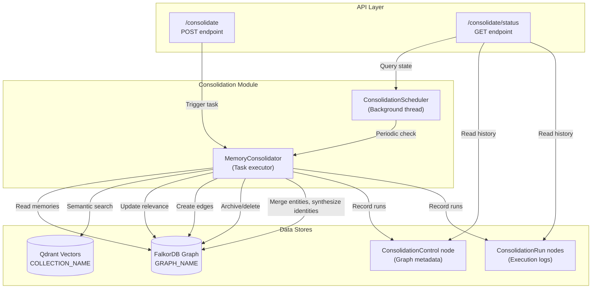
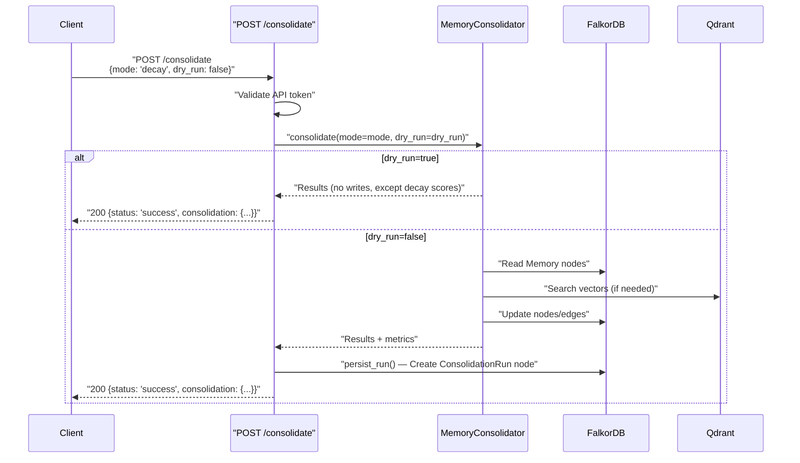

:::note[Source files]
- [automem/api/consolidation.py](https://github.com/verygoodplugins/automem/blob/5df0b83eb37a34b1206f89bf5d52190fe5a6ccdb/automem/api/consolidation.py#L22-L69) — Consolidation API endpoints
- [consolidation.py](https://github.com/verygoodplugins/automem/blob/5df0b83eb37a34b1206f89bf5d52190fe5a6ccdb/consolidation.py#L820-L1042) — Consolidation engine implementation
- [automem/consolidation/runtime_scheduler.py](https://github.com/verygoodplugins/automem/blob/5df0b83eb37a34b1206f89bf5d52190fe5a6ccdb/automem/consolidation/runtime_scheduler.py#L21-L27) — Scheduled consolidation runs
- [automem/config.py](https://github.com/verygoodplugins/automem/blob/5df0b83eb37a34b1206f89bf5d52190fe5a6ccdb/automem/config.py#L51-L87) — Decay threshold, identity synthesis, and consolidation control settings
- [app.py](https://github.com/verygoodplugins/automem/blob/5df0b83eb37a34b1206f89bf5d52190fe5a6ccdb/app.py#L273-L289) — API-token guard for all endpoints
- [automem/api/auth_helpers.py](https://github.com/verygoodplugins/automem/blob/5df0b83eb37a34b1206f89bf5d52190fe5a6ccdb/automem/api/auth_helpers.py#L55-L57) — `/health` exemption
- [app.py](https://github.com/verygoodplugins/automem/blob/5df0b83eb37a34b1206f89bf5d52190fe5a6ccdb/app.py#L480-L489) — HTTP error response envelope
:::

This page documents the HTTP API endpoints for triggering and monitoring memory consolidation tasks. Consolidation is AutoMem's background maintenance system that mimics biological memory processes — decay, creative association, clustering, and forgetting. An `identity` task also merges duplicate entities and synthesizes identity definitions for Entity nodes.

For information about the consolidation engine's internal architecture and algorithms, see [Consolidation Engine](/docs/core-concepts/consolidation/).

---

## Overview

AutoMem provides two REST endpoints for consolidation operations:

| Endpoint | Method | Purpose | Auth |
|----------|--------|---------|------|
| `/consolidate` | POST | Manually trigger consolidation tasks | API token |
| `/consolidate/status` | GET | Query scheduler state and last run times | API token |

The consolidation system runs automatically on scheduled intervals (configurable via environment variables), but these endpoints allow manual triggers for testing, debugging, or forcing immediate execution.

---

## System Architecture



---

## POST /consolidate

Manually trigger one or more consolidation tasks.

### Parameters

| Parameter | Type | Required | Default | Description |
|-----------|------|----------|---------|-------------|
| `mode` | string | No | `"full"` | Task type to execute: `decay`, `creative`, `cluster`, `forget`, `identity`, or `full` |
| `dry_run` | boolean | No | `true` | If `true`, `creative`, `cluster`, `forget`, and `identity` report what they would do without writing. `decay` has no dry-run guard and always updates relevance scores, so `mode="decay"` and `mode="full"` write even with the default `dry_run: true` |

### Task Types

| Task | Default Interval | Description | Configuration Variable |
|------|-----------------|-------------|----------------------|
| `decay` | 86400s (24 hours) | Apply exponential relevance decay to memories | `CONSOLIDATION_DECAY_INTERVAL_SECONDS` |
| `creative` | 604800s (7 days) | Discover hidden associations (REM-like) | `CONSOLIDATION_CREATIVE_INTERVAL_SECONDS` |
| `cluster` | 2592000s (30 days) | Group semantically similar memories | `CONSOLIDATION_CLUSTER_INTERVAL_SECONDS` |
| `forget` | 0 (disabled) | Archive/delete low-relevance memories | `CONSOLIDATION_FORGET_INTERVAL_SECONDS` |
| `identity` | 604800s (7 days) when `IDENTITY_SYNTHESIS_ENABLED` is true, otherwise 0 (disabled) | Merge duplicate entities and synthesize identity definitions for Entity nodes (requires an OpenAI client) | `CONSOLIDATION_IDENTITY_INTERVAL_SECONDS` |
| `full` | N/A | Execute `decay`, `creative`, `cluster`, `identity` (when `IDENTITY_SYNTHESIS_ENABLED` is true), then `forget` in sequence | N/A |

`mode="identity"` runs whenever you request it. `IDENTITY_SYNTHESIS_ENABLED` only controls whether `full` includes the identity step and sets the default scheduled interval.

### Execution Flow



### Response Format

#### Success (200 OK)

The `consolidation` object is the engine's result. It echoes `mode` and `dry_run`, adds `started_at` and `completed_at` timestamps plus a `success` flag, and nests each task's statistics under `steps`, keyed by task name. Per-task statistics are not returned at the top level of the object.

```json
{
  "status": "success",
  "consolidation": {
    "mode": "decay",
    "dry_run": false,
    "started_at": "2025-01-15T08:00:00+00:00",
    "steps": {
      "decay": {
        "processed": 42,
        "avg_relevance_before": 0.61,
        "avg_relevance_after": 0.59,
        "distribution": { "high": 30, "medium": 9, "low": 2, "archive": 1 }
      }
    },
    "completed_at": "2025-01-15T08:00:01+00:00",
    "success": true
  }
}
```

For `mode="full"`, `steps` contains one entry per task that ran. The tasks run in the order `decay`, `creative`, `cluster`, `identity`, `forget`, and each reports its own keys:

```json
{
  "status": "success",
  "consolidation": {
    "mode": "full",
    "dry_run": false,
    "started_at": "2025-01-15T08:00:00+00:00",
    "steps": {
      "decay": {
        "processed": 42,
        "avg_relevance_before": 0.61,
        "avg_relevance_after": 0.59,
        "distribution": { "high": 30, "medium": 9, "low": 2, "archive": 1 }
      },
      "creative": { "discovered": 8, "created": 8, "sample_associations": [] },
      "cluster": { "clusters_found": 3, "meta_memories_created": 3, "sample_clusters": [] },
      "identity": { "skipped": true, "reason": "Identity synthesis is disabled" },
      "forget": { "examined": 120, "archived": [], "deleted": [], "preserved": 120, "protected": [] }
    },
    "completed_at": "2025-01-15T08:00:10+00:00",
    "success": true
  }
}
```

The `sample_associations` and `sample_clusters` arrays hold the first 3 associations and the first 2 clusters found. They are shown empty here to keep the example short.

A `full` run that completes always includes an `identity` entry. When `IDENTITY_SYNTHESIS_ENABLED` is false, it is reported as skipped, as shown above.

If the engine hits an internal failure, the endpoint still returns `200 OK`, with `success` set to `false` and an `error` string inside `consolidation`. Only an exception raised outside the engine's `consolidate()` call, such as a failure while persisting the run, returns the `500` shape below.

#### Error (500 Internal Server Error)

```json
{
  "error": "Consolidation failed",
  "details": "Connection refused"
}
```

### Usage Examples

**Trigger full consolidation:**

```bash
curl -X POST https://your-automem-instance/consolidate \
  -H "Authorization: Bearer YOUR_TOKEN" \
  -H "Content-Type: application/json" \
  -d '{"mode": "full", "dry_run": false}'
```

**Trigger single task (decay):**

```bash
curl -X POST https://your-automem-instance/consolidate \
  -H "Authorization: Bearer YOUR_TOKEN" \
  -H "Content-Type: application/json" \
  -d '{"mode": "decay", "dry_run": false}'
```

---

## GET /consolidate/status

**Authentication:** API token required

Query the current state of the consolidation scheduler and retrieve execution history.

The number of history records returned is controlled server-side by `CONSOLIDATION_HISTORY_LIMIT` (default: 20); this endpoint accepts no query parameters.

### Response Format

```json
{
  "status": "success",
  "next_runs": {
    "decay": "In 7 hour(s)",
    "creative": "In 3 day(s)",
    "cluster": "In 24 day(s)",
    "forget": "Disabled",
    "identity": "Disabled"
  },
  "history": [
    {
      "id": "3f2b8c1d4e5a4f6b9a7c0d1e2f3a4b5c",
      "mode": "decay",
      "task": "decay",
      "success": true,
      "dry_run": false,
      "started_at": "2025-01-15T08:00:00+00:00",
      "completed_at": "2025-01-15T08:00:01+00:00",
      "result": "{\"mode\": \"decay\", \"dry_run\": false, \"started_at\": \"2025-01-15T08:00:00+00:00\", \"steps\": {\"decay\": {\"processed\": 42, \"avg_relevance_before\": 0.61, \"avg_relevance_after\": 0.59, \"distribution\": {\"high\": 30, \"medium\": 9, \"low\": 2, \"archive\": 1}}}, \"completed_at\": \"2025-01-15T08:00:01+00:00\", \"success\": true}"
    }
  ],
  "thread_alive": true,
  "tick_seconds": 60
}
```

### Response Fields

| Field | Type | Description |
|-------|------|-------------|
| `status` | string | Always `"success"` |
| `next_runs.<task>` | string | Human-readable time until the task is next due, not a timestamp: `"Due now"`, `"In N day(s)"`, `"In N hour(s)"` (whole hours, so under an hour reads `"In 0 hour(s)"`), or `"Disabled"` when the task's interval is 0. Keys are `decay`, `creative`, `cluster`, `forget`, and `identity` |
| `history[]` | object | The properties of one `ConsolidationRun` node, newest `started_at` first |
| `history[].id` | string | Run ID (UUID hex) |
| `history[].mode` | string | Mode that was run |
| `history[].task` | string | Same value as `mode` |
| `history[].success` | boolean | `false` when the engine reported an internal failure |
| `history[].dry_run` | boolean | Whether the run was a dry run. Dry runs are not recorded by `POST /consolidate`, and scheduled runs are never dry runs, so records written by those paths show `false` |
| `history[].started_at` | string (ISO 8601) | Run start time |
| `history[].completed_at` | string (ISO 8601) | Run completion time |
| `history[].result` | string | The full `consolidation` result object, serialized as a JSON string. Parse it to read per-task statistics under `steps` |
| `thread_alive` | boolean | Whether the background scheduler thread is active |
| `tick_seconds` | integer | Polling interval for the scheduler loop |

### Usage Examples

**Check last run times and history:**

```bash
curl "https://your-automem-instance/consolidate/status" \
  -H "Authorization: Bearer YOUR_TOKEN"
```

---

## Control Node Storage

Consolidation state is persisted in FalkorDB using two node types:

### ConsolidationControl Node

Properties correspond to the `CONSOLIDATION_TASK_FIELDS` mapping in `automem/config.py`. A single `ConsolidationControl` node (with ID controlled by `CONSOLIDATION_CONTROL_NODE_ID`, defaulting to `"global"`) stores the last run timestamp for each task (`decay`, `creative`, `cluster`, `forget`, `identity`, and `full`).

### ConsolidationRun Nodes

Each recorded execution (scheduled runs and `POST /consolidate` calls with `dry_run` set to `false`) creates a `ConsolidationRun` node in FalkorDB. The `/consolidate/status` endpoint reads the most recent `ConsolidationRun` nodes ordered by `started_at` descending, up to the number configured by `CONSOLIDATION_HISTORY_LIMIT` (default 20).

---

## Configuration

Consolidation behavior is controlled via environment variables:

| Variable | Default | Description |
|----------|---------|-------------|
| `CONSOLIDATION_TICK_SECONDS` | 60 | Scheduler loop polling interval |
| `CONSOLIDATION_DECAY_INTERVAL_SECONDS` | 86400 | Minimum time between decay runs |
| `CONSOLIDATION_CREATIVE_INTERVAL_SECONDS` | 604800 | Minimum time between creative runs |
| `CONSOLIDATION_CLUSTER_INTERVAL_SECONDS` | 2592000 | Minimum time between cluster runs |
| `CONSOLIDATION_FORGET_INTERVAL_SECONDS` | 0 | Minimum time between forget runs (0 = disabled) |
| `IDENTITY_SYNTHESIS_ENABLED` | `false` | Include the `identity` step in `full` runs (accepts `1`, `true`, or `yes`) |
| `CONSOLIDATION_IDENTITY_INTERVAL_SECONDS` | 604800 when `IDENTITY_SYNTHESIS_ENABLED` is true, otherwise 0 | Minimum time between identity runs (0 = disabled) |
| `CONSOLIDATION_DECAY_IMPORTANCE_THRESHOLD` | 0.3 | Scheduled `decay` runs only process memories whose `importance` is at or above this value; lower-importance memories are skipped. Only the background scheduler passes it. A manual `POST /consolidate` sends no threshold, so it decays all non-archived memories |
| `CONSOLIDATION_PROTECTED_TYPES` | `"Decision,Insight"` | Memory types exempt from forget task |
| `CONSOLIDATION_GRACE_PERIOD_DAYS` | 90 | Days before a memory is eligible for forgetting |
| `CONSOLIDATION_DELETE_THRESHOLD` | 0.0 | Relevance score below which memories are deleted |
| `CONSOLIDATION_ARCHIVE_THRESHOLD` | 0.0 | Relevance score below which memories are archived |
| `CONSOLIDATION_HISTORY_LIMIT` | 20 | Default number of history records to return |
| `CONSOLIDATION_CONTROL_NODE_ID` | `"global"` | ID of the ConsolidationControl node |

**Example configuration:**

```bash
CONSOLIDATION_TICK_SECONDS=30
CONSOLIDATION_DECAY_INTERVAL_SECONDS=1800
CONSOLIDATION_CREATIVE_INTERVAL_SECONDS=3600
CONSOLIDATION_CLUSTER_INTERVAL_SECONDS=14400
CONSOLIDATION_FORGET_INTERVAL_SECONDS=43200
CONSOLIDATION_DECAY_IMPORTANCE_THRESHOLD=0.4
```

---

## Authentication

Both `POST /consolidate` and `GET /consolidate/status` require authentication using the `AUTOMEM_API_TOKEN`. Unlike `/health`, which is exempt from token checks, `/consolidate/status` is not a public endpoint. Three authentication methods are supported for authenticated endpoints:

1. **Bearer Token** (recommended): `Authorization: Bearer <token>`
2. **Custom Header**: `X-API-Key: <token>`
3. **Query Parameter** (discouraged in production): `?api_key=<token>`

Requests to authenticated endpoints without valid authentication receive a `401 Unauthorized` response.

---

## Error Handling

### Client Errors (4xx)

| Status | Condition | Response |
|--------|-----------|----------|
| 401 Unauthorized | Missing or invalid token | `{"status": "error", "code": 401, "message": "Unauthorized"}` |

### Server Errors (5xx)

| Status | Condition | Response |
|--------|-----------|----------|
| 500 Internal Server Error | Task execution exception (POST) | `{"error": "Consolidation failed", "details": "<exception message>"}` |
| 500 Internal Server Error | Status query failure (GET) | `{"error": "Failed to get status", "details": "<exception message>"}` |
| 503 Service Unavailable | FalkorDB is unavailable (both endpoints, before any work starts) | `{"status": "error", "code": 503, "message": "FalkorDB is unavailable"}` |

The two `500` handlers log only the exception message at error level, not a stack trace.

---

## Integration with Background Scheduler

The `ConsolidationScheduler` runs in a background thread started at application initialization. It periodically checks whether each task's interval has elapsed and executes tasks automatically without manual triggers.

The `/consolidate` endpoint triggers immediate execution of consolidation tasks regardless of the scheduler's last run times.

:::tip[When to trigger manual consolidation]
Manually trigger consolidation after:
- Importing a large batch of memories (run `full` to build initial associations)
- Debugging consolidation behavior (individual task runs)
:::
