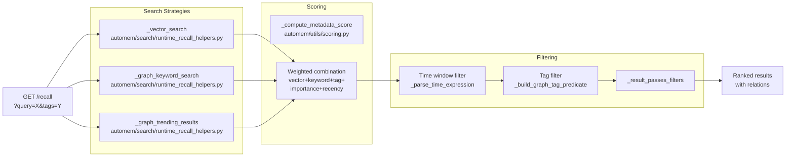
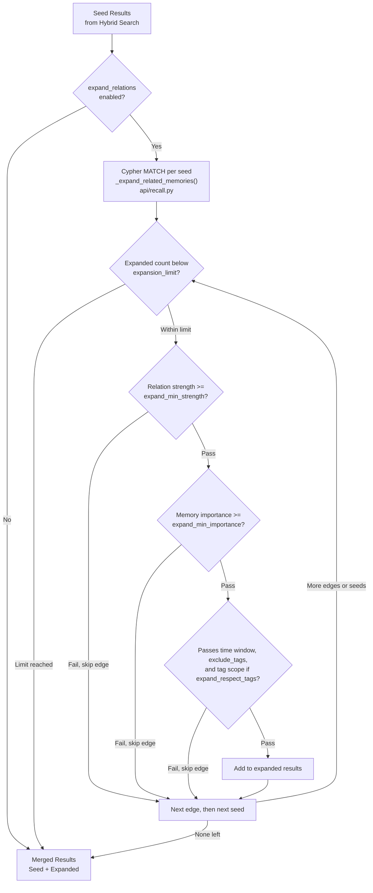
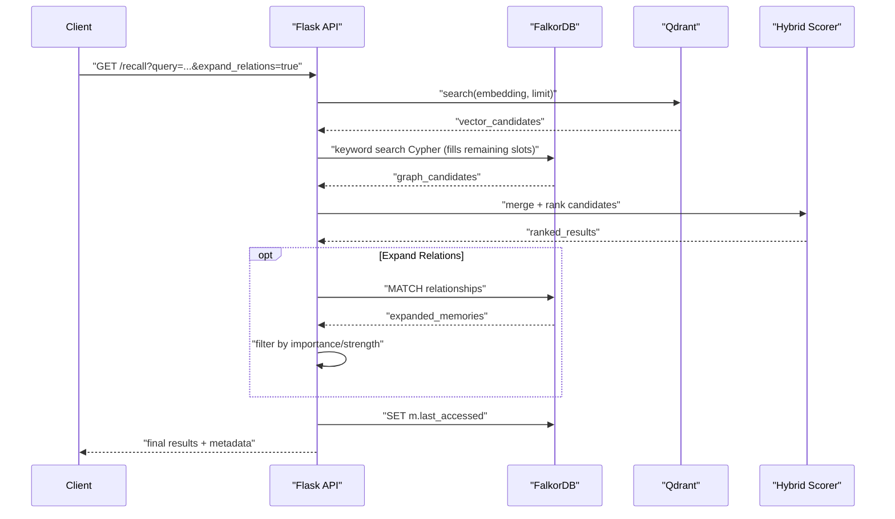

:::note[Source files]
- [automem/api/recall.py](https://github.com/verygoodplugins/automem/blob/5df0b83eb37a34b1206f89bf5d52190fe5a6ccdb/automem/api/recall.py) — Recall endpoint and graph expansion logic (`_expand_related_memories`)
- [automem/search/runtime_recall_helpers.py](https://github.com/verygoodplugins/automem/blob/5df0b83eb37a34b1206f89bf5d52190fe5a6ccdb/automem/search/runtime_recall_helpers.py) — Vector/keyword/trending search helpers
- [automem/utils/scoring.py](https://github.com/verygoodplugins/automem/blob/5df0b83eb37a34b1206f89bf5d52190fe5a6ccdb/automem/utils/scoring.py) — Scoring algorithm (`_compute_metadata_score`)
- [automem/config.py](https://github.com/verygoodplugins/automem/blob/5df0b83eb37a34b1206f89bf5d52190fe5a6ccdb/automem/config.py) — Score weight and recall tuning configuration
- [src/index.ts](https://github.com/verygoodplugins/mcp-automem/blob/1f9daefc758d6a66fe96711de815d5f2c3dbb601/src/index.ts) — MCP `recall_memory` tool
- [src/recall-memory.ts](https://github.com/verygoodplugins/mcp-automem/blob/1f9daefc758d6a66fe96711de815d5f2c3dbb601/src/recall-memory.ts) — MCP recall response budgeting and formatting
- [src/automem-client.ts](https://github.com/verygoodplugins/mcp-automem/blob/1f9daefc758d6a66fe96711de815d5f2c3dbb601/src/automem-client.ts) — HTTP client and response normalization
:::

The recall system provides a single unified endpoint that supports multiple search strategies. It combines 10 scoring components into a hybrid ranking system and supports both basic retrieval and advanced graph expansion. Authentication is required via `Authorization: Bearer <token>` header or `X-API-Key` header.

## Endpoint Overview

```
GET /recall
```

---

## Request Parameters

### Basic Search Parameters

| Parameter | Type | Default | Description |
|-----------|------|---------|-------------|
| `query` | string | — | Natural language search query or wildcard `*` |
| `embedding` | array[float] | — | Pre-computed embedding vector for semantic search |
| `limit` | integer | 5 | Maximum results to return (capped at `RECALL_MAX_LIMIT=100`) |
| `sort` / `order_by` | string | `score` | Sort mode: `score`, `time_desc`, `time_asc`, `updated_desc`, `updated_asc` |

The `query` parameter triggers keyword extraction and full-text search. When `query="*"` or is omitted, the system returns trending memories ordered by importance.

### Tag Filtering Parameters

| Parameter | Type | Default | Description |
|-----------|------|---------|-------------|
| `tags` | array[string] | — | Tags to filter by (can specify multiple) |
| `exclude_tags` | array[string] | — | Tags to exclude (supports prefix matching) |
| `tag_mode` | string | `any` | Match mode: `any` or `all` |
| `tag_match` | string | `prefix` | Match type: `prefix` or `exact` |

Tag filtering uses pre-computed `tag_prefixes` stored in both FalkorDB and Qdrant for efficient prefix matching. The `exclude_tags` parameter removes any memory containing ANY of the specified tags.

**Prefix matching example:**
- Query: `tags=slack`
- Matches: `slack:channel:general`, `slack:user:U123`, `slack:reaction:thumbs-up`
- Matches against the precomputed `tag_prefixes` field, which stores each tag's segment prefixes (`slack`, `slack:channel`, `slack:channel:general`), so a prefix filter is an exact membership check instead of a `STARTS WITH` scan

**Mode behavior:**
- `any` (default): Match if ANY filter tag present
- `all`: Match only if ALL filter tags present

### Temporal Filtering Parameters

| Parameter | Type | Default | Description |
|-----------|------|---------|-------------|
| `time_query` | string | — | Natural language time expression (e.g., `"last week"`) |
| `start` | string | — | ISO 8601 start timestamp |
| `end` | string | — | ISO 8601 end timestamp |

Time queries are parsed by `_parse_time_expression()` from `automem/utils/time.py`, which supports expressions like `"last 7 days"`, `"yesterday"`, `"last month"`. Explicit timestamps override natural language queries.

### Context Hint Parameters

| Parameter | Type | Default | Description |
|-----------|------|---------|-------------|
| `context` | string | — | Contextual hint for ranking (e.g., `"programming task"`) |
| `language` | string | — | Programming language context (e.g., `"python"`) |
| `active_path` | string | — | File path being edited (auto-detects language) |
| `context_tags` | array[string] | — | Tags to boost in scoring |
| `context_types` | array[string] | — | Memory types to prioritize |
| `priority_ids` | array[string] | — | Memory IDs to boost during scoring and fetch directly when the search missed them |

Context hints add an unweighted context bonus to the final score (see the formula under [Hybrid Scoring System](#hybrid-scoring-system)) but do not filter results. When `active_path` matches a coding language extension, the system prioritizes `Style` type memories for that language.

:::note[`priority_ids` semantics]
`priority_ids` adds a fixed +0.9 context bonus to matching memories during scoring. A listed ID that the search did not surface is fetched directly by ID and returned with `match_type: "priority_id"`, and listed IDs are placed ahead of other candidates before results are trimmed to `limit`. It does **not** bypass filters or guarantee inclusion. If a listed ID fails the tag gate, time window, or other query constraints (including `exclude_tags`, `min_score`, the current-state filter, and the adaptive score floor), it will still be excluded. To guarantee a specific memory is returned, fetch it directly via [`GET /memory/{id}`](/docs/reference/api/memory-operations/) instead of relying on `priority_ids`.
:::

### Graph Expansion Parameters

| Parameter | Type | Default | Description |
|-----------|------|---------|-------------|
| `expand_relations` | boolean | false | Follow graph edges from seed results |
| `expand_entities` | boolean | false | Multi-hop reasoning via entity tags |
| `relation_limit` | integer | 5 | Max relations per seed (from `RECALL_RELATION_LIMIT`) |
| `expansion_limit` | integer | 25 | Total max expanded memories (from `RECALL_EXPANSION_LIMIT`) |
| `expand_min_importance` | float | 0.0 | Minimum importance threshold for expanded memories |
| `expand_min_strength` | float | 0.0 | Minimum relation strength to traverse |
| `expand_respect_tags` | boolean | false | Restrict graph expansion to memories within the active tag scope |

Graph expansion operates in two phases: seed results from hybrid search, then expansion via graph traversal. Expansion filtering parameters only apply to expanded memories, never to seed results.

### State Filtering Parameters

State filtering is the largest behavior change in 0.16: **recall now returns current state only by default.** The current-state filter suppresses expired, not-yet-valid, archived, and invalidated/evolved memories, and `state_mode=history` turns that filter off. Supersession chains resolve to their head — if memory A was superseded by B and B by C (`INVALIDATED_BY` / `EVOLVED_INTO`), a recall that would surface A returns C instead. Resolution is bounded at 5 hops and is cycle-safe.

| Parameter | Type | Default | Description |
|-----------|------|---------|-------------|
| `state_mode` | string | `current` | `current` returns active memories only; `history` skips the current-state filter, so superseded, expired, and not-yet-valid memories can be returned. Archived memories stay excluded from the vector, keyword, trending, tag-only, and metadata candidate searches. Any other value returns 400 |
| `current_only` | boolean | — | Legacy flag. `true` == `state_mode=current`, `false` == `state_mode=history`. When both are set and resolve, `current_only` **wins** |
| `state_debug` | boolean | false | Adds suppression and replacement detail (which memories were hidden and what replaced them) under a `state_filter` object in the response. Only has an effect when the current-state filter runs; a `history` response has no `state_filter` |

:::note[Default changed in 0.16]
Before 0.16, recall returned every matching memory regardless of lifecycle state. As of 0.16 the default is `state_mode=current` — to retrieve superseded, expired, or not-yet-valid memories you must pass `state_mode=history` (or the legacy `current_only=false`).
:::

### Metadata Sidecar Search

Text queries can admit a bounded set of additional candidates when the query strongly matches whitelisted metadata values (the metadata "sidecar"). This is enabled by default and controlled by the `RECALL_METADATA_SEARCH_ENABLED` environment variable — there is **no request parameter**.

The sidecar runs after vector and keyword candidates are merged. It reserves up to `max(1, min(limit, 10))` slots and can **upgrade** memories already in the candidate pool (their IDs are passed as `include_seen_ids`) so a strong metadata match is not dropped when the vector pool is full. Sidecar matches still pass the same tag, time, and state filters as other candidates.

### Vector Candidate Over-fetch

Vector search returns more candidates than the requested `limit` so the hybrid re-rank can surface high-importance or exact-match memories that rank slightly lower on raw cosine similarity alone. The fetch size is:

```
max(limit, min(limit × RECALL_VECTOR_OVERFETCH, RECALL_VECTOR_FETCH_CAP))
```

Tag-scoped queries with text or an explicit embedding may widen the pool further (still capped by `RECALL_VECTOR_FETCH_CAP`). The response is trimmed to `limit` after scoring — over-fetch does not increase payload size. Defaults: `RECALL_VECTOR_OVERFETCH=4`, `RECALL_VECTOR_FETCH_CAP=200`. Set `RECALL_VECTOR_OVERFETCH=1` to restore legacy 1× vector fetch behavior.

### Internal Artifact Type Exclusion

User-facing `/recall` results exclude internal artifact memory types (for example consolidation `MetaPattern` cluster summaries). Filtering is controlled by `RECALL_EXCLUDED_TYPES` (default `MetaPattern`, comma-separated). At AutoMem 0.16.2 the same list also applies to the `/health` memory and vector counts, `/admin/sync`, and the background sync worker's drift repair, so internal artifacts are not counted there either.

### Relative-Recency Bias

| Parameter | Type | Default | Description |
|-----------|------|---------|-------------|
| `recency_bias` | string | from `RECALL_RECENCY_BIAS` (ships `off`) | `off`, `on`, or `auto`. Re-ranks score order toward more recent memories. `auto` activates only on temporal-intent queries |

When the recency re-rank activates, the response echoes the applied `recency_bias` value.

### Scoped Fallback

| Parameter | Type | Default | Description |
|-----------|------|---------|-------------|
| `scope_fallback` | boolean | false | When tag-scoped results fall short of `limit` and a `query` is present, fill the remaining slots from an unscoped vector search |

Fallback fills are appended **after** the scoped results, and each carries `outside_tag_scope: true`. The `exclude_tags`, time-window, `min_score`, and current-state filters still apply to fallback candidates.

### Weak-Result Gating

| Parameter | Type | Default | Description |
|-----------|------|---------|-------------|
| `min_score` | float | from `RECALL_MIN_SCORE` (ships `0.0`, disabled) | Minimum final score for a result to be returned |
| `adaptive_floor` | boolean | from `RECALL_ADAPTIVE_FLOOR` (ships `true`) | Adjusts the minimum score floor based on overall result quality, dropping weak outliers |

---

## Hybrid Search Architecture



**Search strategy:**
1. **Vector Search** (`state.qdrant != None`): Semantic similarity using the configured embedding provider (Voyage by default)
2. **Keyword Search** (FalkorDB): Content and tag matching using Cypher `CONTAINS`, run only when vector search returned fewer candidates than the per-query limit, to fill the remaining slots
3. **Trending Results** (no query): High-importance memories ordered by recency
4. **Deduplication**: Track seen IDs across sources
5. **Filtering**: Apply temporal and tag constraints
6. **Scoring**: Combine weighted factors into final score
7. **Relations**: Fetch connected memories (limited by `RECALL_RELATION_LIMIT`)

---

## Hybrid Scoring System

### 10-Component Score Calculation

```mermaid
graph TB
    Query["Query Input"]

    subgraph VectorSearch["Vector Search (Qdrant)"]
        VectorComp["Vector Component<br/>Weight: SEARCH_WEIGHT_VECTOR<br/>Cosine similarity score"]
    end

    subgraph KeywordSearch["Keyword Search (FalkorDB)"]
        KeywordComp["Keyword Component<br/>Weight: SEARCH_WEIGHT_KEYWORD<br/>Keyword-search match score, or share<br/>of query keywords found in content"]
    end

    subgraph MetadataSidecar["Metadata Sidecar Search"]
        MetadataComp["Metadata Component<br/>Weight: SEARCH_WEIGHT_METADATA<br/>Metadata sidecar channel match"]
    end

    subgraph MetadataScoring["Metadata Scoring"]
        ImportanceComp["Importance Component<br/>Weight: SEARCH_WEIGHT_IMPORTANCE<br/>User-assigned priority"]
        ConfidenceComp["Confidence Component<br/>Weight: SEARCH_WEIGHT_CONFIDENCE<br/>Classification confidence"]
        RecencyComp["Recency Component<br/>Weight: SEARCH_WEIGHT_RECENCY<br/>Freshness boost"]
        TagComp["Tag Component<br/>Weight: SEARCH_WEIGHT_TAG<br/>Tag overlap score"]
        ExactComp["Exact Component<br/>Weight: SEARCH_WEIGHT_EXACT<br/>Whole-query exact match against metadata terms"]
    end

    subgraph ContextScoring["Context Scoring"]
        RelationComp["Relation Component<br/>Weight: SEARCH_WEIGHT_RELATION<br/>Computed from graph edges"]
        RelevanceComp["Relevance Component<br/>Weight: SEARCH_WEIGHT_RELEVANCE<br/>Consolidation decay score"]
    end

    FinalScore["Final Weighted Score<br/>Sum of all components"]

    Query --> VectorSearch
    Query --> KeywordSearch
    Query --> MetadataSidecar
    Query --> MetadataScoring
    Query --> ContextScoring

    VectorComp --> FinalScore
    KeywordComp --> FinalScore
    ExactComp --> FinalScore
    MetadataComp --> FinalScore
    ImportanceComp --> FinalScore
    ConfidenceComp --> FinalScore
    RecencyComp --> FinalScore
    TagComp --> FinalScore
    RelationComp --> FinalScore
    RelevanceComp --> FinalScore
```



The formula:

```
final_score = (vector_score × SEARCH_WEIGHT_VECTOR) +
              (keyword_score × SEARCH_WEIGHT_KEYWORD) +
              (metadata_score × SEARCH_WEIGHT_METADATA) +
              (exact_match_score × SEARCH_WEIGHT_EXACT) +
              (importance × SEARCH_WEIGHT_IMPORTANCE) +
              (confidence × SEARCH_WEIGHT_CONFIDENCE) +
              (recency_score × SEARCH_WEIGHT_RECENCY) +
              (tag_score × SEARCH_WEIGHT_TAG) +
              (relation_score × SEARCH_WEIGHT_RELATION) +
              (relevance_score × SEARCH_WEIGHT_RELEVANCE) +
              context_bonus
```

`context_bonus` is added without a weight and is 0 when no context profile applies (see [Context Hint Parameters](#context-hint-parameters)). The sum is not normalized, so `final_score` can exceed 1.0. When [`recency_bias`](#relative-recency-bias) activates, a separate re-rank then adds `SEARCH_WEIGHT_TEMPORAL * relative_recency` (default weight 0.1) to `final_score`; it is off by default.

**Default weight configuration (all configurable via environment variables):**

| Component | Environment Variable | Default Value |
|-----------|---------------------|---------------|
| Vector | `SEARCH_WEIGHT_VECTOR` | 0.35 |
| Keyword | `SEARCH_WEIGHT_KEYWORD` | 0.35 |
| Metadata | `SEARCH_WEIGHT_METADATA` | 0.35 |
| Exact | `SEARCH_WEIGHT_EXACT` | 0.20 |
| Importance | `SEARCH_WEIGHT_IMPORTANCE` | 0.10 |
| Confidence | `SEARCH_WEIGHT_CONFIDENCE` | 0.05 |
| Recency | `SEARCH_WEIGHT_RECENCY` | 0.10 |
| Tag | `SEARCH_WEIGHT_TAG` | 0.20 |
| Relation | `SEARCH_WEIGHT_RELATION` | 0.25 |
| Relevance | `SEARCH_WEIGHT_RELEVANCE` | 0.0 |

### Scoring Component Details

**Vector Search Component:**

Executes via `_vector_search()` using Qdrant when available. When Qdrant is unavailable, the system gracefully degrades to graph-only mode using keyword and metadata scoring.

**Keyword Search Component:**

Implemented in `_graph_keyword_search()` using Cypher queries:
- Extracts keywords via `_extract_keywords()` from `automem/utils/text.py`
- Matches against `m.content` and `m.tags` fields in FalkorDB
- Scores based on keyword frequency and phrase containment
- Returns memories ordered by `score DESC, m.importance DESC, m.timestamp DESC`
- Content match: 2 points per keyword
- Tag match: 1 point per keyword
- Exact phrase bonus: +2 (content) or +1 (tag)

**Metadata Sidecar Component:**

The dedicated `SEARCH_WEIGHT_METADATA` component only applies to candidates admitted via the metadata sidecar search channel (see `RECALL_METADATA_SEARCH_ENABLED`) — it is separate from the importance/confidence/recency/tag sub-scores below.

**Importance, Confidence, Recency & Tag Sub-Scores:**

Computed by `_compute_metadata_score()` and `_parse_metadata_field()`, each with its own independent weight in the final formula above:
- **Importance**: Direct multiplication by weight (0.0–1.0 range)
- **Confidence**: Classification confidence from memory type detection
- **Recency**: `max(0, 1 - (age_days / SEARCH_RECENCY_WINDOW_DAYS))` — linear decay that reaches zero at the recency window (default 180 days), measured from the memory's `timestamp` rather than `last_accessed`. Set `SEARCH_RECENCY_CURVE=exp` for exponential decay, `0.5 ** (age_days / SEARCH_RECENCY_WINDOW_DAYS)`, where the window is the half-life. A missing or unparseable `timestamp` scores 0.0
- **Tag**: `min(1, matched_tokens / total_query_tokens)` — the share of query keywords that exactly match one of the memory's tags or metadata terms

---

## Graph Expansion

### Relationship Expansion Flow



The `_expand_related_memories()` function expands each seed memory by one hop, using a Cypher `MATCH` to follow typed relationship edges (e.g., `RELATES_TO`, `PREFERS_OVER`, `LEADS_TO`). Edges are ordered by update time (falling back to the related memory's `timestamp`), newest first, and capped at `relation_limit` per seed.

**Key configuration constants:**
- `RECALL_RELATION_LIMIT` (default: 5) — Max edges per seed memory
- `RECALL_EXPANSION_LIMIT` (default: 25) — Total expanded memories cap
- `RECALL_MIN_SCORE` (default: 0.0, disabled) — Minimum score threshold for results to be returned
- `RECALL_ADAPTIVE_FLOOR` (default: true) — Adaptive floor that adjusts minimum score based on result quality

**Edge types traversed:** the relationship types flagged `default_expand` in the relationship registry: `RELATES_TO`, `LEADS_TO`, `OCCURRED_BEFORE`, `PREFERS_OVER`, `EXEMPLIFIES`, `CONTRADICTS`, `REINFORCES`, `INVALIDATED_BY`, `EVOLVED_INTO`, `DERIVED_FROM`, and `PART_OF`. The system-generated `SIMILAR_TO`, `PRECEDED_BY`, and `DISCOVERED` edges are not followed. See [Relationship Operations](/docs/reference/api/relationships/) for the full type reference.

### Entity Expansion Flow

When `expand_entities=true`, the system performs multi-hop reasoning via entity tags. It runs once, after the seed results and any relation expansion are assembled, and only when Qdrant is available:

1. Collect entities from the seed memories and any relation-expanded memories: `metadata.entities` (people, places, organizations) and `entity:people:<slug>` tags
2. For up to 5 of those entities, one after another, search for memories tagged `entity:people:<slug>` (up to 5 per entity, capped by `expansion_limit`)
3. Return the new memories with `match_type: "entity_expansion"` and `expanded_from_entity`

**Example:** Query `"What is Sarah's sister's job?"` → Hybrid search finds the seed memory `"Sarah's sister is Rachel"` → Find memories tagged for `rachel` → Find Rachel's job.

### Auto Query Decomposition

When `auto_decompose: true`, the backend automatically extracts entities and topics from the query to generate supplementary searches:

- Query: `"React OAuth authentication patterns"`
- Searched as: the original query plus up to three topic keywords, `["React OAuth authentication patterns", "react", "oauth", "authentication"]` (no names are detected in this query)
- When a query does contain capitalized names (at most two are used), each name is searched alone and combined with up to three topic keywords instead of the topic keywords alone
- Runs the searches one after another, not in parallel
- Merges and deduplicates results

### Multiple Query Deduplication

The `queries` parameter (array of strings) allows multiple search queries in a single request. The backend executes them one after another and deduplicates results server-side.

**Deduplication logic:**
1. Each query returns up to `per_query_limit` results (default `limit`)
2. Server merges results by `memory_id`
3. Keeps highest-scored version of each memory
4. Returns `dedup_removed` count in response metadata

### MCP Client Routing (MCP Layer)

The MCP `recall_memory` tool (`src/automem-client.ts`) routes requests through three mutually exclusive branches — only one executes per call:

1. **ID fetch mode:** If `memory_id` is provided, short-circuits to `GET /memory/{id}` and returns immediately without evaluating other parameters.
2. **Enumeration mode:** If `exhaustive: true` is set (with tags), routes to `GET /memory/by-tag`. The following ranked-only parameters are rejected with a validation error in this mode: `query`, `queries`, `embedding`, `time_query`, `start`, `end`, `exclude_tags`, `expand_relations`, `expand_entities`, `auto_decompose`, `expansion_limit`, `relation_limit`, `expand_min_importance`, `expand_min_strength`, `current_only`, `state_debug`, `state_mode`, `recency_bias`, `scope_fallback`, `expand_respect_tags`, `min_score`, `adaptive_floor`, `sort`, `context`, `language`, `active_path`, `context_tags`, `context_types`, `priority_ids`, and `per_query_limit`. Only `tags`, `limit`, `offset`, `tag_mode: "any"`, `tag_match: "exact"`, and `format` are accepted.
3. **Ranked retrieval mode:** All other cases call `GET /recall` with URL parameters built from the tool arguments. `offset > 0` is rejected in this mode because `GET /recall` does not support pagination — raise `limit` instead.

---

## Query Execution Flow



**Typical performance:**
- Sub-100ms for queries without expansion
- 100–300ms with graph expansion enabled
- Scales to 100k+ memories with proper indexing

---

## Response Format

### Standard Response Structure

```json
{
  "status": "success",
  "query": "PostgreSQL database decisions",
  "results": [
    {
      "id": "a1b2c3d4-e5f6-7890-abcd-ef1234567890",
      "memory": {
        "content": "Chose PostgreSQL over MongoDB for the primary database.",
        "tags": ["project-alpha", "database"],
        "importance": 0.9,
        "confidence": 0.9,
        "type": "Decision",
        "timestamp": "2025-01-15T10:30:00+00:00"
      },
      "final_score": 0.792,
      "match_type": "vector",
      "score_components": {
        "vector": 0.82,
        "keyword": 0.6667,
        "metadata": 0.0,
        "relation": 0.0,
        "tag": 0.3333,
        "importance": 0.9,
        "confidence": 0.9,
        "recency": 0.7,
        "exact": 0.0,
        "relevance": 0.0,
        "context": 0.0,
        "evidence": 0.82,
        "relevance_gated": false
      },
      "relations": []
    }
  ],
  "count": 1,
  "dedup_removed": 0,
  "sort": "score",
  "state_mode": "current",
  "state_filter": {
    "current_only": true,
    "suppressed_count": 0,
    "replacement_count": 0
  },
  "keywords": ["postgresql", "database", "decisions"],
  "vector_search": {
    "enabled": true,
    "matched": true
  },
  "tag_mode": "any",
  "tag_match": "prefix",
  "query_time_ms": 47.3
}
```

The sample's numbers follow from the default weights. The query keywords are `postgresql`, `database`, and `decisions`; the content contains two of them (`keyword` 0.6667) and the tags match one (`tag` 0.3333). The vector hit scored 0.82, and the memory is 54 days old when queried, so `recency` is 0.7 on the default 180-day window. `final_score` is then 0.35 × 0.82 + 0.35 × 0.6667 + 0.2 × 0.3333 + 0.1 × 0.9 + 0.05 × 0.9 + 0.1 × 0.7 = 0.792, with no context bonus. Each result also carries bookkeeping fields (`source`, `match_score`, `original_score`, `score`, `_query`) that the sample leaves out. The `memory` object in the sample is abridged too: stored memories can also carry `tag_prefixes`, `updated_at`, `last_accessed`, `t_valid`, `t_invalid`, and `metadata`.

**Result fields:**
- `id`: The memory's ID
- `memory`: The stored memory record (Qdrant payload or FalkorDB node properties) with fields such as `content`, `tags`, `importance`, `timestamp`, `type`, `confidence`, and `metadata`. The memory ID is the result-level `id` (vector hits carry no ID inside `memory`) and the creation time is stored as `timestamp`; the MCP tool presents them as `memory_id` and `created_at`
- `final_score`: Combined relevance score
- `match_type`: Type of match — `vector`, `keyword`, `trending`, `metadata`, `tag`, `relation`, `entity_expansion`, `priority_id`, or `state_replacement`
- `score_components`: Breakdown of scoring factors: the ten weighted components plus `context` (the context bonus), `evidence` (the strongest of the vector, keyword, metadata, and exact scores), and `relevance_gated`. Two keys appear only conditionally: `temporal` (the result's recency relative to the other candidates, 0.0 to 1.0) when the [recency re-rank](#relative-recency-bias) changes scores, and `entity_expansion` (0.15) on entity-expanded results
- `relations`: Connected memories (if expansion enabled)
- `expanded_from_entity`: Entity that triggered expansion (if applicable)
- `deduped_from`: IDs of duplicate results removed

### Expansion Response Fields

When `expand_relations=true`:

```json
{
  "expansion": {
    "enabled": true,
    "seed_count": 3,
    "expanded_count": 5,
    "relation_limit": 5,
    "expansion_limit": 25,
    "respect_tags": false
  }
}
```

When `expand_entities=true`:

```json
{
  "entity_expansion": {
    "enabled": true,
    "expanded_count": 4,
    "entities_found": ["rachel", "platform team"]
  }
}
```

`entities_found` lists up to 10 entity names, lowercased, collected from the seed and relation-expanded results. Expansion searches at most 5 of them, so a listed name did not necessarily produce a result.

---

## Usage Examples

### Basic Text Search

```bash
curl "https://your-automem-instance/recall?query=PostgreSQL+database+decisions&limit=5" \
  -H "Authorization: Bearer YOUR_TOKEN"
```

### Semantic Search with Pre-computed Vector

```bash
curl "https://your-automem-instance/recall?embedding=0.1,0.2,0.3,...&limit=10" \
  -H "Authorization: Bearer YOUR_TOKEN"
```

### Time-Filtered Search

```bash
# Natural language time filter
curl "https://your-automem-instance/recall?time_query=last+week&query=bug+fixes" \
  -H "Authorization: Bearer YOUR_TOKEN"

# Explicit time range
curl "https://your-automem-instance/recall?start=2025-01-01T00:00:00Z&end=2025-01-31T23:59:59Z" \
  -H "Authorization: Bearer YOUR_TOKEN"
```

### Tag-Based Filtering

```bash
# Any tag match (default)
curl "https://your-automem-instance/recall?tags=project-alpha&tags=database" \
  -H "Authorization: Bearer YOUR_TOKEN"

# All tags required
curl "https://your-automem-instance/recall?tags=project-alpha&tags=database&tag_mode=all" \
  -H "Authorization: Bearer YOUR_TOKEN"

# Exclude certain tags
curl "https://your-automem-instance/recall?query=preferences&exclude_tags=conversation&exclude_tags=temp" \
  -H "Authorization: Bearer YOUR_TOKEN"
```

### Context-Aware Coding Search

```bash
curl "https://your-automem-instance/recall?query=error+handling&active_path=src/auth.ts&context_types=Style&context_types=Pattern" \
  -H "Authorization: Bearer YOUR_TOKEN"
```

Auto-detects TypeScript context → boosts `Style` type memories → prioritizes language-specific patterns.

### Graph Expansion with Filtering

```bash
curl "https://your-automem-instance/recall?query=authentication&expand_relations=true&expand_min_strength=0.3&expand_min_importance=0.5" \
  -H "Authorization: Bearer YOUR_TOKEN"
```

Performs hybrid search for seed results → follows graph edges with strength ≥ 0.3 → filters expanded memories with importance ≥ 0.5.

### Multi-Hop Entity Search

```bash
curl "https://your-automem-instance/recall?query=Sarah%27s+sister%27s+job&expand_entities=true" \
  -H "Authorization: Bearer YOUR_TOKEN"
```

### Current-State Recall (Default)

```bash
# Default: only current memories — superseded, expired, and not-yet-valid memories are suppressed
curl "https://your-automem-instance/recall?query=database+choice&state_debug=true" \
  -H "Authorization: Bearer YOUR_TOKEN"

# Opt into history: skip the current-state filter so superseded and expired memories can be returned
curl "https://your-automem-instance/recall?query=database+choice&state_mode=history" \
  -H "Authorization: Bearer YOUR_TOKEN"
```

The first call resolves supersession chains to their head and hides invalidated memories; with `state_debug=true` it reports what was suppressed and what replaced it under `state_filter`. The second skips that filter, so its response has no `state_filter` object.

---

## Sorting Modes

### Score-Based Sorting (Default)

When `sort=score` (or unspecified with query), results are ordered by the final hybrid score: the sum of all 10 weighted components plus the unweighted context bonus (plus the re-rank term when [`recency_bias`](#relative-recency-bias) is active).

### Time-Based Sorting

Time-based sorting modes are designed for "what happened since X" queries:
- `time_desc` / `updated_desc`: Newest first (ordered by `coalesce(m.updated_at, m.timestamp)`)
- `time_asc` / `updated_asc`: Oldest first

When a time window is specified without a query, the system defaults to `time_desc` to show recent activity.

---

## MCP Tool: `recall_memory`

The `recall_memory` MCP tool wraps `GET /recall` with additional client-side optimizations. It is annotated `readOnlyHint: true` and `idempotentHint: true`.

**Full input schema:**

| Parameter | Type | Required | Constraints | Description |
|-----------|------|----------|-------------|-------------|
| `memory_id` | string | No | — | ID fetch mode: returns the single memory via `GET /memory/{id}` and ignores all other parameters |
| `exhaustive` | boolean | No | — | Tag enumeration mode: requires non-empty `tags` and routes to `GET /memory/by-tag` instead of ranked recall |
| `query` | string | No | — | Semantic search query |
| `queries` | array[string] | No | — | Multiple queries for broader recall |
| `embedding` | array[number] | No | — | Pre-computed embedding vector for direct similarity search |
| `limit` | integer | No | 1–200 | Max results to return. When omitted, the server defaults to 5 in ranked mode and 20 in enumeration mode; ranked recall is capped server-side (default 100 via `RECALL_MAX_LIMIT`) and enumeration at 200 |
| `tags` | array[string] | No | — | Filter by tags |
| `exclude_tags` | array[string] | No | — | Ranked mode only: tags to exclude (any match excludes; independent of `tag_match`) |
| `tag_mode` | string | No | `"any"` or `"all"` | Tag matching mode |
| `tag_match` | string | No | `"exact"` or `"prefix"` | Tag matching strategy |
| `time_query` | string | No | — | Natural language time filter |
| `start` | string | No | ISO timestamp | Time range start |
| `end` | string | No | ISO timestamp | Time range end |
| `expand_entities` | boolean | No | — | Enable multi-hop entity expansion |
| `expand_relations` | boolean | No | — | Follow graph relationships |
| `expansion_limit` | integer | No | 1–500, default 25 | Max expanded results |
| `relation_limit` | integer | No | 1–200, default 5 | Relations per seed memory |
| `expand_min_importance` | number | No | 0–1 | Filter expanded results by importance |
| `expand_min_strength` | number | No | 0–1 | Min relation strength to traverse |
| `expand_respect_tags` | boolean | No | — | Restrict graph expansion to memories within the active tag scope |
| `context` | string | No | — | Context label for boosting |
| `language` | string | No | — | Programming language hint |
| `active_path` | string | No | — | Current file path for language detection |
| `context_tags` | array[string] | No | — | Priority tags to boost |
| `context_types` | array[string] | No | — | Priority memory types to boost |
| `priority_ids` | array[string] | No | — | Memory IDs to boost during scoring and fetch directly when the search missed them (does not bypass filters) |
| `auto_decompose` | boolean | No | — | Auto-extract entities and topics from query to generate supplementary searches |
| `per_query_limit` | integer | No | 1–50, default `limit` | Per-query result limit when using `queries` |
| `state_mode` | string | No | `"current"` or `"history"` | Lifecycle filter; default `current` (current-state only) |
| `current_only` | boolean | No | schema default `true` | Legacy lifecycle flag; wins over `state_mode` when both resolve. The client forwards it only when the call sets it |
| `state_debug` | boolean | No | schema default `false` | Include suppression/replacement detail in `state_filter` |
| `recency_bias` | string | No | `"off"`, `"on"`, or `"auto"` | Relative-recency re-rank; default from `RECALL_RECENCY_BIAS` |
| `scope_fallback` | boolean | No | — | Fill short tag-scoped results from an unscoped vector search |
| `min_score` | number | No | 0–1 | Minimum final score gate for returned results; default from `RECALL_MIN_SCORE` (ships `0.0`, disabled) |
| `adaptive_floor` | boolean | No | — | Adaptive score-floor gating based on result quality; default from `RECALL_ADAPTIVE_FLOOR` (ships `true`) |
| `sort` | string | No | `"score"`, `"time_desc"`, `"time_asc"`, `"updated_desc"`, or `"updated_asc"` | Result ordering; the server default is `score`, or `time_desc` when a time window is given without a query (use `time_*` for chronological recaps) |
| `format` | string | No | `"text"`, `"items"`, `"detailed"`, or `"json"`; default `"text"` | Output format (see [MCP Response Formatting](#mcp-response-formatting)) |
| `offset` | integer | No | 0 or more | Enumeration mode only (`exhaustive: true`): records to skip when paging. Ranked recall rejects `offset > 0`, so raise `limit` instead |

**Output schema:**

| Field | Type | Required | Description |
|-------|------|----------|-------------|
| `count` | integer | Yes | Number of memories returned |
| `results` | array | Yes | Array of memory objects with scores |
| `mode` | string | No | Mode that produced the result: `ranked`, `enumeration`, or `id_fetch` |
| `has_more` | boolean | No | Enumeration mode only: true if more records exist past this page |
| `limit` | integer | No | Enumeration mode only: page size of this response |
| `offset` | integer | No | Enumeration mode only: offset used for this response |
| `next_offset` | integer | No | Enumeration mode only, when `has_more` is true: the `offset` for the next page |
| `truncation` | object | No | Present when the response budget cut anything |
| `dedup_removed` | integer | No | Duplicates removed in multi-query |

The schema also declares the ranked-recall diagnostics `query`, `sort`, `exclude_tags`, `state_filter`, `state_mode`, `tag_scope`, `scope_fallback`, `recency_bias`, `score_filter`, `queries`, `vector_search`, `jit_enriched_count`, `query_time_ms`, and `entities`. `structuredContent` can also carry fields the schema does not declare: `expansion`, `entity_expansion`, `time_window`, `tags`, `keywords`, `tag_mode`, `tag_match`, and `context_priority`.

### MCP Response Formatting

Budgeted formats (`text`, `items`, `detailed`) trim each memory to stay under MCP client tool-response caps (~25k tokens in Claude Code). The formatter in `src/recall-memory.ts`:

- Cuts content longer than 400 characters to a 400-character preview and flags it with `content_truncated` and `content_chars` (the full length)
- Keeps a server-generated `summary` as an additional field; it stands in for the preview in the text channel only when `content` is empty
- In `detailed`, collapses relations to compact stubs (max 3 per memory, 100-char summaries); stubs include `id`, `from` (the seed memory for expanded results or the suppressed memory for state replacements), `type`, `strength`, `kind`, and `summary`
- In `detailed`, collapses metadata to its key list
- Applies a global token budget (default 18,000 estimated tokens; override with `AUTOMEM_RECALL_TOKEN_BUDGET`); the budget bounds the **whole serialized response** (`structuredContent` plus every text block), not just the results array

`format: "json"` keeps raw per-field passthrough, including `t_valid`, `t_invalid`, and `archived` on each memory, but the global budget still applies. **ID fetches** via `memory_id` are never truncated and also include `t_valid`, `t_invalid`, and `archived` — use that mode to retrieve a full record.

**Enumeration pages trimmed by the budget** still report `has_more: true` and advance `next_offset` so pagers can continue normally. If the record at the current offset is too large to fit in the budget at all, the tool returns an error rather than an empty page.

**Recall errors** (API failures, validation errors, budget-too-small) are returned as `isError: true` tool results so the calling AI sees them as tool errors rather than empty responses.

Each memory in budgeted `text` output is a numbered list item:

```
1. [summary or preview] [tags] (importance: X) score=X.XXX [match_type] relations=X
   ID: mem-abc123
   Created: 2025-01-15T10:30:00Z
```

A summary line includes statistics when applicable:

```
(3 duplicates removed; 5 via entity expansion (rachel, platform team); 2 via relation expansion)
```

The MCP response also includes `structuredContent` with the (possibly budget-trimmed) `RecallResult` object for programmatic consumption.

### Common MCP Patterns

**Session start — load recent project context:**

```json
{
  "queries": ["recent decisions", "user preferences"],
  "tags": ["preference"],
  "time_query": "last 30 days",
  "limit": 10
}
```

**Preference recall (no time filter needed):**

```json
{
  "tags": ["preference"],
  "limit": 10
}
```

**Debug pattern search:**

```json
{
  "query": "authentication timeout error",
  "tags": ["bug-fix", "auth"],
  "limit": 5
}
```

**Multi-hop reasoning:**

```json
{
  "query": "What does Amanda's sister do?",
  "expand_entities": true,
  "expansion_limit": 10
}
```

**Filtered graph exploration:**

```json
{
  "query": "database architecture",
  "expand_relations": true,
  "expand_min_strength": 0.5,
  "expand_min_importance": 0.7,
  "relation_limit": 3
}
```

---

## Error Handling

### Service Degradation

| Condition | Behavior | HTTP Status |
|-----------|----------|------------|
| FalkorDB unavailable | Graph-backed steps (keyword, trending, metadata, relation expansion) are skipped; vector search still runs | 200 |
| Qdrant unavailable | Graph-only mode (keyword + metadata) | 200 |
| Embedding generation fails | Falls back to a deterministic placeholder vector, so vector hits are not semantically meaningful | 200 |
| No query and no tags | Returns trending memories | 200 |

The system implements graceful degradation where vector search failures don't block graph operations.

### Validation Errors

| Error | HTTP Status | Condition |
|-------|-------------|-----------|
| Invalid embedding dimensions | 400 | Vector size doesn't match `VECTOR_SIZE` |
| Invalid `start` or `end` | 400 | Not a valid ISO 8601 timestamp |
| Invalid `state_mode` | 400 | Not `current` or `history` |
| Limit exceeds maximum | 200 | Clamped to `RECALL_MAX_LIMIT` |
| Missing authentication | 401 | No valid token provided |

An unrecognized `time_query` expression is not an error: it is ignored, and only `start` and `end`, if given, set the time window. Error responses use the body `{"status": "error", "code": <HTTP status>, "message": "<description>"}`.

---

## Performance Optimization Techniques

1. **Tag Prefix Indexing**: Pre-computed `tag_prefixes` turn prefix matching into an exact match on stored prefixes, which Qdrant serves from a keyword payload index
2. **Sequential Candidate Search**: Vector search runs first, and graph keyword search only fills the slots it leaves open
3. **Deferred Relation Hydration**: `relations` for vector hits are fetched only after scoring, filtering, and trimming, so over-fetched candidates that are dropped never trigger graph relation queries
4. **Access Tracking**: `last_accessed` updates for the seed matches (not expanded memories) run synchronously, in one batched write before the response is returned
